**VectorFFT** is a double-precision FFT library in C for x86 with AVX2 and
AVX-512, built for workloads that run many transforms of modest length. It serves
complex (c2c), real (r2c, c2r) and real-to-real (DCT, DST, DHT) transforms in 1D,
2D and 3D, in place or out of place, in both complex layouts, interleaved and
split, batched and threaded. Its kernels are emitted by its own DAG FFT compiler
for each instruction set; the split layout has its AVX-512 kernels today, the
interleaved layout's follow from the same compiler. You never pick an algorithm:
a call names a contract, the planner races the engines that serve it on your
machine, and the winner is kept as wisdom, so the first create measures and
every later one replays.

---

## How to Use

The user guide, [`VectorFFT-Guide.html`](how-to-use/VectorFFT-Guide.html)
([PDF](how-to-use/VectorFFT-Guide.pdf)), shows how to build and install the library, how to
call it from C and C++, and how to move a program written for Intel MKL's DFTI interface
to it; worked 3D examples are in [`how-to-use/examples/`](how-to-use/examples/).

---

## Benchmark Results

> **Full performance record** — every gauntlet run, multi-threaded scaling, the
> 2D/3D tiers, accuracy and hardware caveats — is
> [`docs/performance/v1_0_results.md`](docs/performance/v1_0_results.md).
> The runs themselves (csv, calibration logs, banked wisdom) are in
> [`gauntlet/results/`](gauntlet/results/); this section's record is
> [`gauntlet_2_4096_2026-09-23`](gauntlet/results/gauntlet_2_4096_2026-09-23/), and
> [`gauntlet/`](gauntlet/) is the tool that reproduces it on your own machine.

> **Platform:** Intel Core i9-14900KF (P-core, AVX2), DDR5, GCC 15.2, single thread  
> **Competitor:** Intel oneMKL 2025.3 (sequential, `mkl_set_num_threads(1)`)  
> **Contract:** 1D complex-to-complex FP64, interleaved, natural order, out of place, K = 1  
> **Cells:** every length N from 2 to 4,096 — 4,095 transforms, no size skipped

### 1D throughput, every N from 2 to 4,096 — VectorFFT vs Intel MKL

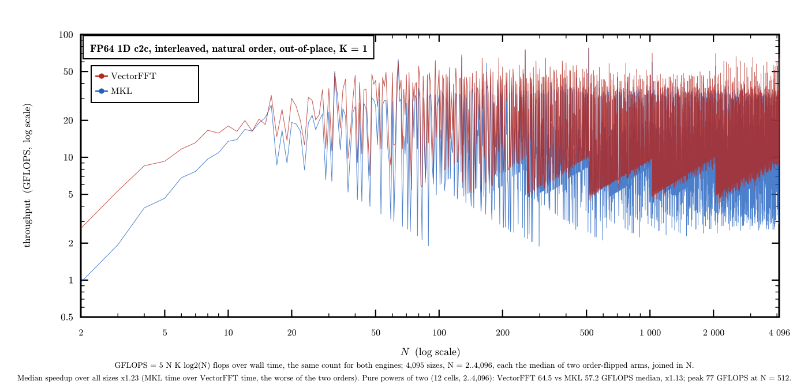

One line per engine, one point per length, joined in N. Each point is the median
of two timing arms with the engine order flipped; every ratio below takes the
**worse** of the two arms, so a win is never an artefact of order. The saw-tooth is
the arithmetic of the lengths themselves: powers of two and smooth composites reach
60-77 GFLOPS, primes and rough composites run at 5-10 GFLOPS on both engines, and on
those VectorFFT sits above MKL by a steady offset (log scale: equal speed ratios are
equal vertical gaps).

| Lengths | Cells | Median speedup | At or above parity |
|---|---|---|---|
| 2..64 | 63 | 1.54x | 92% |
| 65..1,024 | 960 | 1.46x | 94% |
| 1,025..4,096 | 3,072 | 1.26x | 88% |
| Powers of two | 12 | 1.13x | 75% |
| Primes | 564 | 1.18x | 89% |
| Other composites | 3,520 | 1.30x | 89% |
| **all, 2..4,096** | **4,095** | **1.29x** | **89%** |

### AVX-512 1D throughput — AMD Ryzen 7 9800X3D vs FFTW

> **Platform:** AMD Ryzen 7 9800X3D, the AVX-512 build for any AVX-512 CPU (`-mavx512f -mavx512dq -mfma`), GCC 16.2, single thread  
> **Competitor:** FFTW 3.3.10 (`FFTW_MEASURE`), single thread  
> **Plans:** VectorFFT's estimate (`VFFT_FLAG_ESTIMATE`), computed from formulas with nothing measured  
> **Contract:** complex-to-complex FP64, interleaved, natural order, out of place, K = 1  
> **Cells:** the regression test's cells ([`tests/regression/`](tests/regression/)): 179 1D lengths from 8 to 2^24, 145 planes and 85 volumes  
> **Record:** the three `regression_*_9800x3d` folders of [`tests/performance_results/`](tests/performance_results/README.md) (2026-11-21, commit 7229967d)

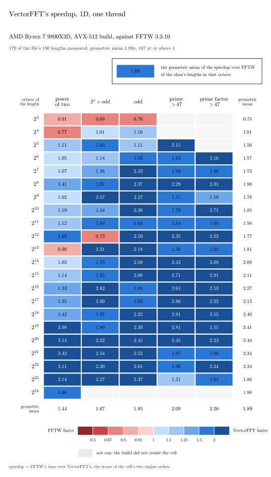

| Rank | Cells | Median speedup | At or above parity | Best |
|---|---|---|---|---|
| 1D | 179 | 1.89x | 93% | 4.46x (N=516) |
| 2D | 145 | 2.28x | 98% | 5.03x (17x16) |
| 3D | 85 | 2.25x | 94% | 4.41x (67x64x64) |

### 2D throughput, every power-of-two plane up to 4M points — VectorFFT vs Intel MKL

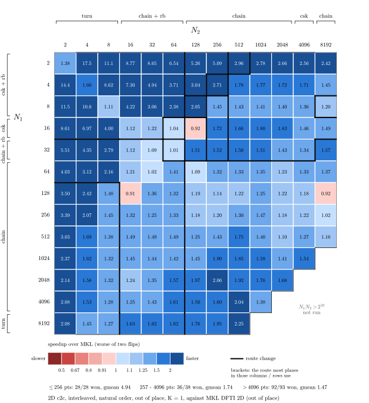

Every route is raced per plane by the planner and banked in
wisdom. The record is
[`gauntlet_2d-pow2grid6_rowkernels_20261108b`](gauntlet/results/gauntlet_2d-pow2grid6_rowkernels_20261108b/).

| Plane size | Cells | Median speedup | At or above parity | Best |
|---|---|---|---|---|
| up to 256 points | 28 | 5.17x | 100% | 18.31x (2x4) |
| 257..4,096 | 38 | 1.66x | 95% | 4.79x (2x256) |
| 4,097..65,536 | 48 | 1.38x | 100% | 2.56x (2x4096) |
| 65,537..4M | 45 | 1.50x | 100% | 2.23x (8192x512) |
| **all, 159 planes** | **159** | **1.52x** | **99%** | 18.31x (2x4) |

The same 159 planes at eight threads, MKL at eight threads too.

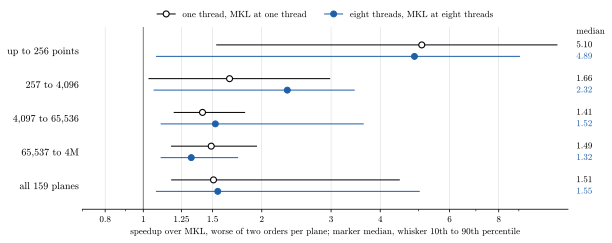

### 3D throughput, every power-of-two volume up to 4M points — VectorFFT vs Intel MKL

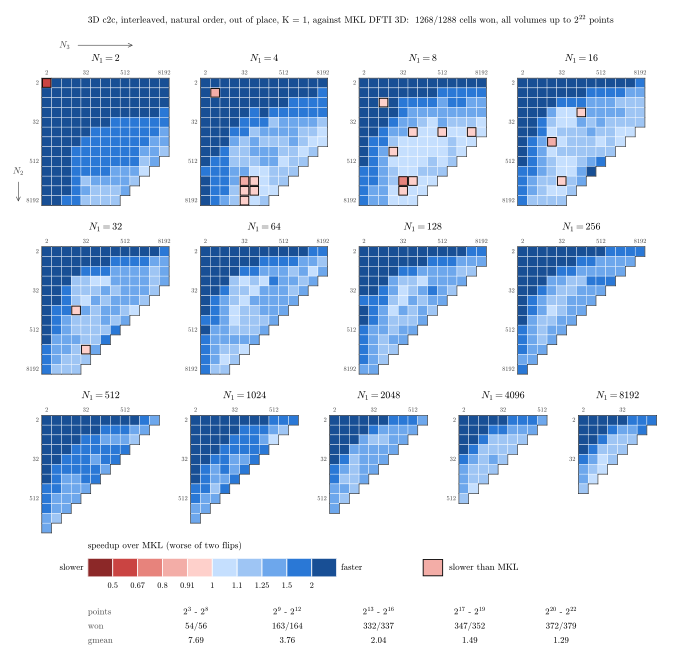

Every volume N1 x N2 x N3 with each side a power of two from 2 to 8,192 and at most 2^22
points: 1,288 transforms, 3D complex-to-complex, interleaved, natural order, out of
place, single thread, against MKL DFTI 3D. One matrix per N1; each cell is the speedup,
worse of the two engine orders, and a cell slower than MKL is outlined. The record is
[`3d-pow2_2026-09-24`](gauntlet/results/3d-pow2_2026-09-24/).

| Volume | Cells | Median speedup | At or above parity |
|---|---|---|---|
| up to 4,096 points | 220 | 4.54x | 99% |
| 4,097..65,536 | 337 | 1.94x | 99% |
| 65,537..1M | 478 | 1.38x | 98% |
| 1M..4M | 253 | 1.26x | 99% |
| **all, 1,288 volumes** | **1,288** | **1.55x** | **98%** |

## Accuracy

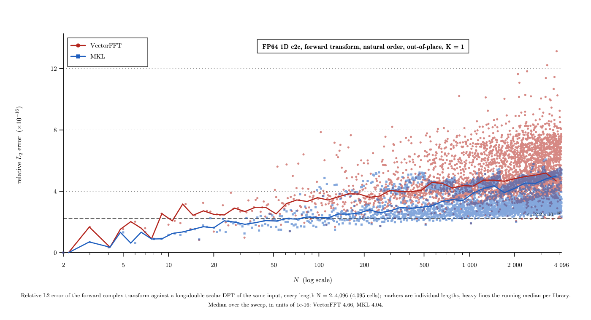

Measured with one-level Rader.

---

## Features

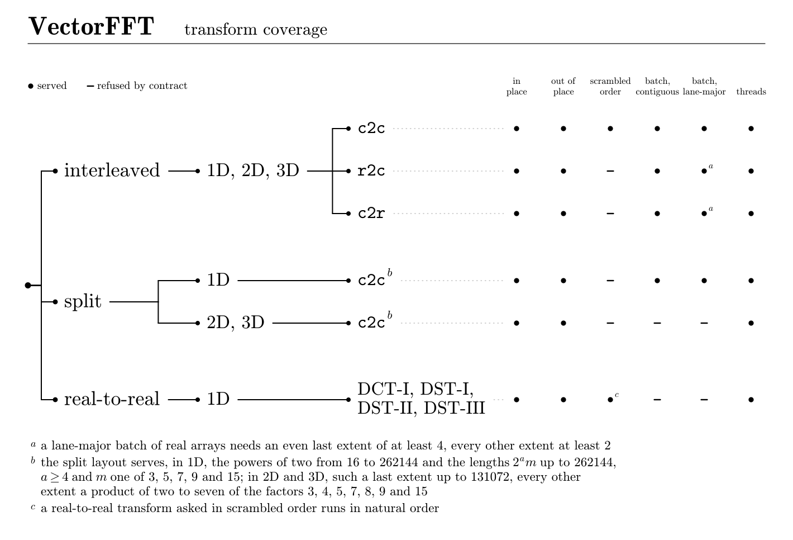

A request names a contract: transform, layout, placement, order, length, batch,
threads. A cell either has a native engine for it or refuses at create; a dot in
the tree is a native engine, a dash a refusal by contract.

- **Interleaved and split are two libraries**, each with its own engines and
  wisdom; nothing is converted between them. The split layout serves c2c; the
  real and real-to-real transforms run interleaved.
- **Both placements**, in place and out of place, for every transform in the
  tree.
- **Order is a contract of interleaved c2c**: natural by default, scrambled on
  request, each served by its own writers. Split c2c and the real and
  real-to-real transforms are natural by construction.
- **Any length, 1D to 3D, batches, threads** in the interleaved layout; the split
  layout serves the lengths its footnote lists.
- **Two ways to plan**, measuring by default or `VFFT_FLAG_ESTIMATE`. The
  estimate plans interleaved c2c, r2c and c2r in 1D to 3D (c2c at 2D and 3D in
  natural order), their batches and threads, and the four real-to-real
  transforms; a split plan is always measured.

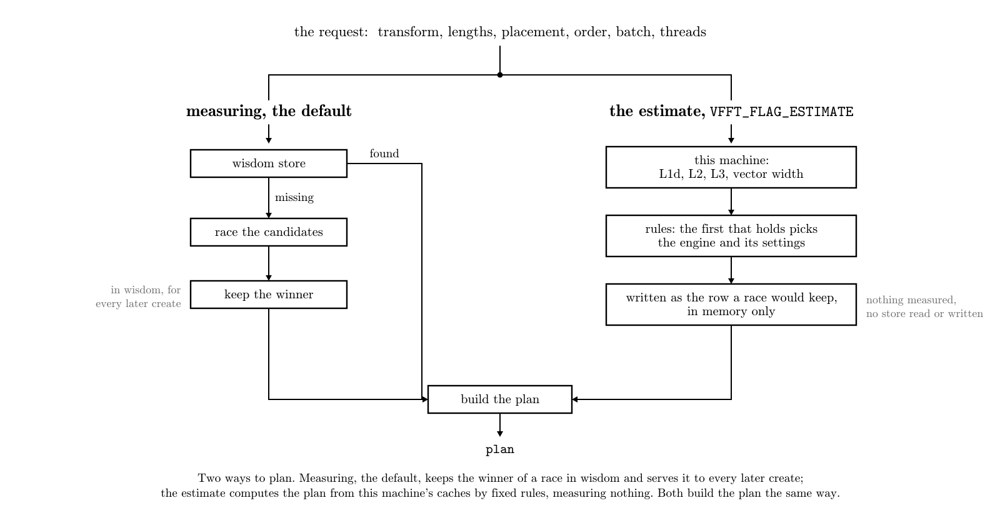

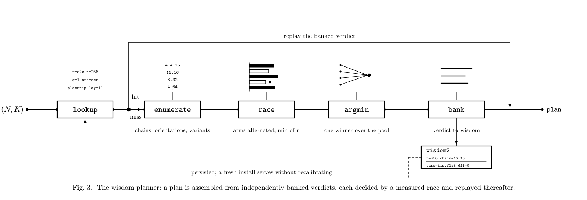

How a plan is chosen: lookup, enumerate, race, argmin, bank. A hit replays the
banked verdict; a miss races once and banks it.

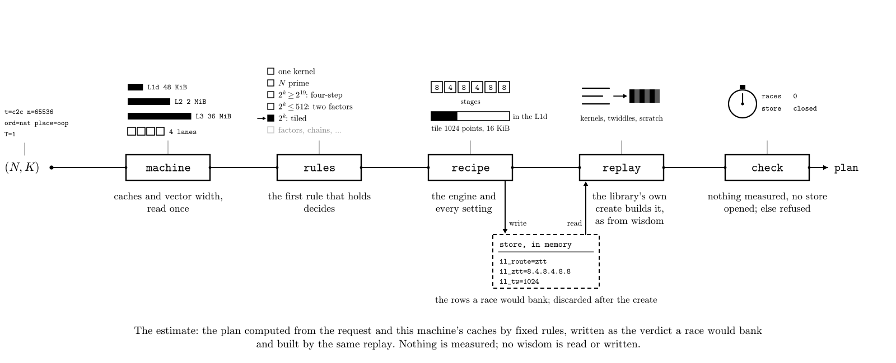

How the estimate computes a plan: machine, rules, recipe, replay, check.

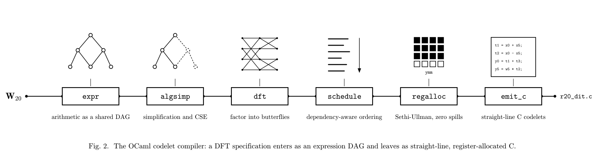

Where the kernels come from: the DAG FFT compiler takes a DFT as an expression
DAG and emits straight-line, register-allocated C per instruction set.

The contracts in full: [`include/vfft.h`](include/vfft.h) (support matrix and
buffer signatures);
every served configuration at work: the [user guide](how-to-use/VectorFFT-Guide.html).

---

