# vfft_create: validation, the layout fork, the tiers

Generated by `src/tools/archgraph.py`. Do not edit.

What `vfft_create` (`vfft_api.h`, line 276) calls, 3 levels deep. A solid arrow is a direct call; a
dashed arrow is a function passed or stored by name (a thread-pool task, a dispatch
table entry, a plan's function pointer). `+N` on a node: N more callees not drawn
(see `functions.md`, or run `python src/tools/archgraph.py --calls NAME`).

```mermaid
flowchart LR
    subgraph n_f__core_["src/core"]
        n_fn__vfft_api_translate["_vfft_api_translate<br/>vfft_api.h"]
        n_fn__vfft_k1_go_mt["_vfft_k1_go_mt<br/>vfft_api.h"]
        n_fn__vfft_store_for_dir["_vfft_store_for_dir<br/>vfft_api.h"]
        n_fn__vfft_wisdom_load["_vfft_wisdom_load +2<br/>vfft.c"]
        n_fn_vfft_create["vfft_create<br/>vfft_api.h"]:::entry
    end
    subgraph n_f_common_support["common/support"]
        n_fn_thread_pool_caller_arm["thread_pool_caller_arm<br/>threads.h"]
        n_fn_thread_pool_caller_release["thread_pool_caller_release<br/>threads.h"]
        n_fn_vfft_cpu_l1d_bytes["vfft_cpu_l1d_bytes<br/>cpu_cache.h"]
        n_fn_vfft_cpu_l1d_ways["vfft_cpu_l1d_ways<br/>cpu_cache.h"]
        n_fn_vfft_cpu_l2_bytes["vfft_cpu_l2_bytes<br/>cpu_cache.h"]
        n_fn_vfft_cpu_l3_bytes["vfft_cpu_l3_bytes<br/>cpu_cache.h"]
    end
    subgraph n_f_common_wisdom["common/wisdom"]
        n_fn_vw2_tcmt_bank["vw2_tcmt_bank +2<br/>wisdom2_tcmt.h"]
    end
    subgraph n_f_il_estimate["il/estimate"]
        n_fn__vfft_create_estimate["_vfft_create_estimate<br/>c2c_estimate_il.h"]
        n_fn__vfft_create_estimate_lm["_vfft_create_estimate_lm<br/>c2c_estimate_lm_il.h"]
        n_fn__vfft_create_estimate_lmr["_vfft_create_estimate_lmr<br/>real_estimate_lm_il.h"]
        n_fn__vfft_create_estimate_nd["_vfft_create_estimate_nd<br/>c2c_estimate_nd_il.h"]
        n_fn__vfft_create_estimate_real["_vfft_create_estimate_real<br/>real_estimate_il.h"]
        n_fn__vfft_create_estimate_real_nd["_vfft_create_estimate_real_nd<br/>real_estimate_nd_il.h"]
        n_fn_est__batch_ok["est__batch_ok<br/>c2c_estimate_il.h"]
        n_fn_est__batch_one["est__batch_one<br/>c2c_estimate_il.h"]
        n_fn_est__check_plan["est__check_plan<br/>c2c_estimate_il.h"]
        n_fn_est__preflight["est__preflight +15<br/>c2c_estimate_il.h"]
        n_fn_est__real_nd_batch_whole["est__real_nd_batch_whole<br/>real_estimate_nd_il.h"]
        n_fn_est_batch_whole["est_batch_whole<br/>estimate_il.h"]
        n_fn_est_build_c2c["est_build_c2c<br/>c2c_estimate_il.h"]
        n_fn_est_build_lm["est_build_lm +3<br/>c2c_estimate_lm_il.h"]
        n_fn_est_build_lmr["est_build_lmr +3<br/>real_estimate_lm_il.h"]
        n_fn_est_build_nd["est_build_nd +8<br/>c2c_estimate_nd_il.h"]
        n_fn_est_build_real["est_build_real +6<br/>real_estimate_il.h"]
        n_fn_est_build_real_2d["est_build_real_2d +2<br/>real_estimate_nd_il.h"]
        n_fn_est_build_real_3d["est_build_real_3d +2<br/>real_estimate_nd_il.h"]
        n_fn_est_build_real_ndb["est_build_real_ndb +6<br/>real_estimate_nd_il.h"]
        n_fn_est_c2c["est_c2c +19<br/>estimate_il.h"]
        n_fn_est_env_steers["est_env_steers<br/>c2c_estimate_il.h"]
        n_fn_est_free_lm["est_free_lm<br/>c2c_estimate_lm_il.h"]
        n_fn_est_free_lmr["est_free_lmr<br/>real_estimate_lm_il.h"]
        n_fn_est_mt_2d["est_mt_2d +6<br/>estimate_nd_il.h"]
        n_fn_est_mt_2d_serial_1t["est_mt_2d_serial_1t<br/>estimate_nd_il.h"]
        n_fn_est_mt_3d["est_mt_3d +5<br/>estimate_nd_il.h"]
        n_fn_est_plan_1d["est_plan_1d<br/>estimate_il.h"]
        n_fn_est_plan_2d_r["est_plan_2d_r +10<br/>estimate_nd_il.h"]
        n_fn_est_plan_2d_real["est_plan_2d_real +12<br/>real_estimate_nd_il.h"]
        n_fn_est_plan_3d["est_plan_3d +7<br/>estimate_nd_il.h"]
        n_fn_est_plan_3d_real["est_plan_3d_real +6<br/>real_estimate_nd_il.h"]
        n_fn_est_plan_lm["est_plan_lm +1<br/>c2c_estimate_lm_il.h"]
        n_fn_est_plan_lmrn["est_plan_lmrn +1<br/>real_estimate_lm_il.h"]
        n_fn_est_plan_real["est_plan_real +4<br/>real_estimate_il.h"]
        n_fn_est_put_rows["est_put_rows +8<br/>estimate_il.h"]
        n_fn_est_rader_window["est_rader_window +4<br/>estimate_il.h"]
    end
    subgraph n_f_il_planning["il/planning"]
        n_fn_vfft_policy_pq_groups_ok["vfft_policy_pq_groups_ok +1<br/>policy_il.h"]
    end
    n_fn__vfft_api_translate --> n_fn__vfft_store_for_dir
    n_fn__vfft_create_estimate --> n_fn__vfft_create_estimate_lm
    n_fn__vfft_create_estimate --> n_fn__vfft_create_estimate_lmr
    n_fn__vfft_create_estimate --> n_fn__vfft_create_estimate_nd
    n_fn__vfft_create_estimate --> n_fn__vfft_create_estimate_real
    n_fn__vfft_create_estimate --> n_fn__vfft_create_estimate_real_nd
    n_fn__vfft_create_estimate --> n_fn_est_build_c2c
    n_fn__vfft_create_estimate --> n_fn_est_env_steers
    n_fn__vfft_create_estimate --> n_fn_est_plan_1d
    n_fn__vfft_create_estimate --> n_fn_vfft_cpu_l1d_bytes
    n_fn__vfft_create_estimate --> n_fn_vfft_cpu_l1d_ways
    n_fn__vfft_create_estimate --> n_fn_vfft_cpu_l2_bytes
    n_fn__vfft_create_estimate --> n_fn_vfft_cpu_l3_bytes
    n_fn__vfft_create_estimate_lm --> n_fn_est_build_lm
    n_fn__vfft_create_estimate_lm --> n_fn_est_free_lm
    n_fn__vfft_create_estimate_lm --> n_fn_est_plan_lm
    n_fn__vfft_create_estimate_lmr --> n_fn_est_build_lmr
    n_fn__vfft_create_estimate_lmr --> n_fn_est_free_lmr
    n_fn__vfft_create_estimate_lmr --> n_fn_est_plan_lmrn
    n_fn__vfft_create_estimate_nd --> n_fn_est_batch_whole
    n_fn__vfft_create_estimate_nd --> n_fn_est_build_nd
    n_fn__vfft_create_estimate_nd --> n_fn_est_mt_2d
    n_fn__vfft_create_estimate_nd --> n_fn_est_mt_2d_serial_1t
    n_fn__vfft_create_estimate_nd --> n_fn_est_mt_3d
    n_fn__vfft_create_estimate_nd --> n_fn_est_plan_2d_r
    n_fn__vfft_create_estimate_nd --> n_fn_est_plan_3d
    n_fn__vfft_create_estimate_real --> n_fn_est_build_real
    n_fn__vfft_create_estimate_real --> n_fn_est_plan_real
    n_fn__vfft_create_estimate_real_nd --> n_fn_est__real_nd_batch_whole
    n_fn__vfft_create_estimate_real_nd --> n_fn_est_build_real_2d
    n_fn__vfft_create_estimate_real_nd --> n_fn_est_build_real_3d
    n_fn__vfft_create_estimate_real_nd --> n_fn_est_build_real_ndb
    n_fn__vfft_create_estimate_real_nd --> n_fn_est_plan_2d_real
    n_fn__vfft_create_estimate_real_nd --> n_fn_est_plan_3d_real
    n_fn__vfft_create_estimate_real_nd --> n_fn_vfft_policy_pq_groups_ok
    n_fn__vfft_k1_go_mt --> n_fn_thread_pool_caller_arm
    n_fn__vfft_k1_go_mt --> n_fn_thread_pool_caller_release
    n_fn__vfft_store_for_dir --> n_fn__vfft_wisdom_load
    n_fn_est_build_c2c --> n_fn_est__batch_ok
    n_fn_est_build_c2c --> n_fn_est__batch_one
    n_fn_est_build_c2c --> n_fn_est__check_plan
    n_fn_est_build_c2c --> n_fn_est__preflight
    n_fn_est_build_c2c --> n_fn_est_put_rows
    n_fn_est_build_c2c --> n_fn_vw2_tcmt_bank
    n_fn_est_plan_1d --> n_fn_est_batch_whole
    n_fn_est_plan_1d --> n_fn_est_c2c
    n_fn_est_plan_1d --> n_fn_est_rader_window
    n_fn_vfft_create --> n_fn__vfft_api_translate
    n_fn_vfft_create --> n_fn__vfft_create_estimate
    n_fn_vfft_create -.-> n_fn__vfft_k1_go_mt
    classDef entry stroke-width:3px
```

Shared helpers left out (6 or more callers each): `_vfft_create_cfg`, `_vfft_create_lock`, `_vfft_create_unlock`, `_vfft_scope_create_done`, `_vfft_tname`, `_vfft_warn`, `_vw2_lay_of`, `est__meter_read`, `est__replay`, `est_refuse`, `vfft_child_store_free`, `vfft_child_store_new`, `vfft_cpu_cache`, `vfft_destroy`, `vfft_env_init`, `vfft_policy_batch_lane_major`, `vfft_policy_ord_k1`, `vfft_topology`.

Best effort: calls through function pointers and macros are not followed; both
sides of every `#if` are read.
