# the INTERLEAVED side of the create fork

Generated by `src/tools/archgraph.py`. Do not edit.

What `_vfft_il_create` (`il/il_create.h`, line 53) calls, 2 levels deep. A solid arrow is a direct call; a
dashed arrow is a function passed or stored by name (a thread-pool task, a dispatch
table entry, a plan's function pointer). `+N` on a node: N more callees not drawn
(see `functions.md`, or run `python src/tools/archgraph.py --calls NAME`).

```mermaid
flowchart LR
    subgraph n_f_il["il"]
        n_fn__il_real_row_refused["_il_real_row_refused<br/>il_create.h"]
        n_fn__vfft_il_create["_vfft_il_create<br/>il_create.h"]:::entry
    end
    subgraph n_f_il_isa["il/isa"]
        n_fn_vfft_il_row_fn["vfft_il_row_fn<br/>il_solo_registry.h"]
        n_fn_vfft_il_rowt_fn["vfft_il_rowt_fn<br/>il_solo_registry.h"]
    end
    subgraph n_f_il_planning["il/planning"]
        n_fn_vfft_policy_il2d_ip_ok["vfft_policy_il2d_ip_ok<br/>policy_il.h"]
        n_fn_vfft_policy_il2d_ip_pitch["vfft_policy_il2d_ip_pitch<br/>policy_il.h"]
        n_fn_vfft_policy_ilnd_batch_ok["vfft_policy_ilnd_batch_ok<br/>policy_il.h"]
        n_fn_vfft_policy_ilndr_batch_ok["vfft_policy_ilndr_batch_ok<br/>policy_il.h"]
        n_fn_vfft_policy_k1_engine_present["vfft_policy_k1_engine_present<br/>policy_il.h"]
        n_fn_vfft_policy_lm_axis_nat["vfft_policy_lm_axis_nat<br/>policy_il.h"]
        n_fn_vfft_policy_pq_groups_ok["vfft_policy_pq_groups_ok<br/>policy_il.h"]
        n_fn_vfft_policy_rankn_axis_nat["vfft_policy_rankn_axis_nat<br/>policy_il.h"]
    end
    subgraph n_f_il_rank1["il/rank1"]
        n_fn__c2c_ip_create_il["_c2c_ip_create_il<br/>c2c_ip_create_il.h"]
        n_fn__c2c_ip_finish_il["_c2c_ip_finish_il +4<br/>c2c_ip_create_il.h"]
        n_fn__c2c_oop_create_k1_il["_c2c_oop_create_k1_il +15<br/>c2c_oop_create_il.h"]
        n_fn__c2c_oop_finish_il["_c2c_oop_finish_il +4<br/>c2c_oop_create_il.h"]
        n_fn__ilprime_create_banked["_ilprime_create_banked +12<br/>k1_commit.h"]
        n_fn__ip_order_is_nat["_ip_order_is_nat<br/>c2c_ip_create_il.h"]
        n_fn__k1_il_candidate["_k1_il_candidate +19<br/>k1_commit.h"]
        n_fn__k1_il_mono_candidate["_k1_il_mono_candidate +2<br/>k1_commit.h"]
        n_fn__k1fs_child_row_store["_k1fs_child_row_store +2<br/>k1_fourstep.h"]
        n_fn__vfft_create_c2c_oop_il["_vfft_create_c2c_oop_il<br/>c2c_oop_create_il.h"]
        n_fn__vfft_create_lm_il["_vfft_create_lm_il<br/>lm_batch_il.h"]
        n_fn_vfft_ztt_bind["vfft_ztt_bind<br/>ztt.h"]
    end
    subgraph n_f_il_rank2["il/rank2"]
        n_fn__il2d_axis_race["_il2d_axis_race +8<br/>il2d_tier.h"]
        n_fn__il2d_c2c_build_clone_sets_all["_il2d_c2c_build_clone_sets_all +1<br/>il2d_tier.h"]
        n_fn__il2d_c2c_build_clones["_il2d_c2c_build_clones +1<br/>il2d_tier.h"]
        n_fn__il2d_c2c_drop_unneeded_clones["_il2d_c2c_drop_unneeded_clones +1<br/>il2d_tier.h"]
        n_fn__il2d_c2c_mt_race["_il2d_c2c_mt_race +9<br/>il2d_tier.h"]
        n_fn__il2d_children_put["_il2d_children_put<br/>il2d_tier.h"]
        n_fn__il2d_cxp_plan["_il2d_cxp_plan +4<br/>il2d_real_pitch.h"]
        n_fn__il2d_nat_sscr_build["_il2d_nat_sscr_build<br/>il2d_tier.h"]
        n_fn__il2d_rax_plan["_il2d_rax_plan +6<br/>il2d_real_axis.h"]
        n_fn__il2d_rb2_rows["_il2d_rb2_rows<br/>il2d_tier.h"]
        n_fn__il2d_rcsk_plan["_il2d_rcsk_plan +6<br/>il2d_real_pitch.h"]
        n_fn__il2d_real_children_put["_il2d_real_children_put<br/>il2d_tier.h"]
        n_fn__il2d_real_colmt_race["_il2d_real_colmt_race +3<br/>il2d_tier.h"]
        n_fn__il2d_real_colplan["_il2d_real_colplan +1<br/>il2d_real_plan.h"]
        n_fn__il2d_real_colplan_c2r["_il2d_real_colplan_c2r +1<br/>il2d_real_plan.h"]
        n_fn__il2d_real_destroyplan_c2r["_il2d_real_destroyplan_c2r +11<br/>il2d_real_plan.h"]
        n_fn__il2d_real_rowplan["_il2d_real_rowplan +1<br/>il2d_real_plan.h"]
        n_fn__il2d_real_rowplan_c2r["_il2d_real_rowplan_c2r +1<br/>il2d_real_plan.h"]
        n_fn__il2d_real_sscr_build["_il2d_real_sscr_build +1<br/>il2d_tier.h"]
        n_fn__il2d_real_wlrace["_il2d_real_wlrace +3<br/>il2d_tier.h"]
        n_fn__il2d_rowloop_twin["_il2d_rowloop_twin<br/>il2d_tier.h"]
        n_fn__il2d_tf_plan["_il2d_tf_plan +6<br/>il2d_real_fuse.h"]
        n_fn__lm2d_clones_build["_lm2d_clones_build<br/>lm_batch2d_il.h"]
        n_fn__pq_drop_clones["_pq_drop_clones<br/>fft2d_create_il.h"]
        n_fn__pq_mt_replay_or_race["_pq_mt_replay_or_race +5<br/>plane_queue.h"]
        n_fn__pq_probe_cmp["_pq_probe_cmp<br/>fft2d_create_il.h"]
        n_fn__pq_probe_run["_pq_probe_run<br/>fft2d_create_il.h"]
        n_fn__vfft_create_2d_il["_vfft_create_2d_il<br/>fft2d_create_il.h"]
        n_fn__vfft_create_lm2d_il["_vfft_create_lm2d_il<br/>lm_batch2d_il.h"]
        n_fn__vfft_create_pq_il["_vfft_create_pq_il<br/>fft2d_create_il.h"]
    end
    subgraph n_f_il_rank3["il/rank3"]
        n_fn__ilndr_group_ok["_ilndr_group_ok<br/>fftnd_real_il.h"]
        n_fn__vfft_create_fftnd_il["_vfft_create_fftnd_il +31<br/>fftnd_il.h"]
        n_fn__vfft_create_fftnd_real_il["_vfft_create_fftnd_real_il +22<br/>fftnd_real_il.h"]
        n_fn__vfft_create_lm3d_il["_vfft_create_lm3d_il<br/>lm_batch3d_il.h"]
        n_fn__vfft_create_rank34_il["_vfft_create_rank34_il<br/>fftnd_il.h"]
    end
    subgraph n_f_il_wisdom["il/wisdom"]
        n_fn_vw2_2d_forms_bank["vw2_2d_forms_bank +1<br/>wisdom2_2d_il_reader.h"]
        n_fn_vw2_2d_forms_rebank["vw2_2d_forms_rebank +1<br/>wisdom2_2d_il_reader.h"]
        n_fn_vw2_2d_il_tok_geti["vw2_2d_il_tok_geti<br/>wisdom2_2d_il_reader.h"]
        n_fn_vw2_2d_rl_lookup["vw2_2d_rl_lookup +2<br/>wisdom2_2d_il_reader.h"]
    end
    n_fn__c2c_ip_create_il --> n_fn__c2c_ip_finish_il
    n_fn__c2c_ip_create_il --> n_fn__ilprime_create_banked
    n_fn__c2c_ip_create_il --> n_fn__ip_order_is_nat
    n_fn__c2c_ip_create_il --> n_fn__k1_il_candidate
    n_fn__c2c_ip_create_il --> n_fn__k1_il_mono_candidate
    n_fn__c2c_ip_create_il --> n_fn_vfft_policy_k1_engine_present
    n_fn__c2c_ip_create_il --> n_fn_vfft_ztt_bind
    n_fn__vfft_create_2d_il --> n_fn__il2d_axis_race
    n_fn__vfft_create_2d_il --> n_fn__il2d_c2c_build_clone_sets_all
    n_fn__vfft_create_2d_il --> n_fn__il2d_c2c_build_clones
    n_fn__vfft_create_2d_il --> n_fn__il2d_c2c_drop_unneeded_clones
    n_fn__vfft_create_2d_il --> n_fn__il2d_c2c_mt_race
    n_fn__vfft_create_2d_il --> n_fn__il2d_children_put
    n_fn__vfft_create_2d_il --> n_fn__il2d_cxp_plan
    n_fn__vfft_create_2d_il --> n_fn__il2d_nat_sscr_build
    n_fn__vfft_create_2d_il --> n_fn__il2d_rax_plan
    n_fn__vfft_create_2d_il --> n_fn__il2d_rb2_rows
    n_fn__vfft_create_2d_il --> n_fn__il2d_rcsk_plan
    n_fn__vfft_create_2d_il --> n_fn__il2d_real_children_put
    n_fn__vfft_create_2d_il --> n_fn__il2d_real_colmt_race
    n_fn__vfft_create_2d_il --> n_fn__il2d_real_colplan
    n_fn__vfft_create_2d_il --> n_fn__il2d_real_colplan_c2r
    n_fn__vfft_create_2d_il --> n_fn__il2d_real_destroyplan_c2r
    n_fn__vfft_create_2d_il --> n_fn__il2d_real_rowplan
    n_fn__vfft_create_2d_il --> n_fn__il2d_real_rowplan_c2r
    n_fn__vfft_create_2d_il --> n_fn__il2d_real_sscr_build
    n_fn__vfft_create_2d_il --> n_fn__il2d_real_wlrace
    n_fn__vfft_create_2d_il --> n_fn__il2d_rowloop_twin
    n_fn__vfft_create_2d_il --> n_fn__il2d_tf_plan
    n_fn__vfft_create_2d_il --> n_fn__k1fs_child_row_store
    n_fn__vfft_create_2d_il --> n_fn_vfft_il_row_fn
    n_fn__vfft_create_2d_il --> n_fn_vfft_il_rowt_fn
    n_fn__vfft_create_2d_il --> n_fn_vfft_policy_il2d_ip_ok
    n_fn__vfft_create_2d_il --> n_fn_vfft_policy_il2d_ip_pitch
    n_fn__vfft_create_2d_il --> n_fn_vfft_policy_rankn_axis_nat
    n_fn__vfft_create_2d_il --> n_fn_vw2_2d_forms_bank
    n_fn__vfft_create_2d_il --> n_fn_vw2_2d_forms_rebank
    n_fn__vfft_create_2d_il --> n_fn_vw2_2d_il_tok_geti
    n_fn__vfft_create_2d_il --> n_fn_vw2_2d_rl_lookup
    n_fn__vfft_create_c2c_oop_il --> n_fn__c2c_oop_create_k1_il
    n_fn__vfft_create_c2c_oop_il --> n_fn__c2c_oop_finish_il
    n_fn__vfft_create_lm2d_il --> n_fn__lm2d_clones_build
    n_fn__vfft_create_lm2d_il --> n_fn_vfft_policy_lm_axis_nat
    n_fn__vfft_create_lm3d_il --> n_fn__lm2d_clones_build
    n_fn__vfft_create_lm3d_il --> n_fn_vfft_policy_lm_axis_nat
    n_fn__vfft_create_pq_il --> n_fn__ilndr_group_ok
    n_fn__vfft_create_pq_il --> n_fn__pq_drop_clones
    n_fn__vfft_create_pq_il --> n_fn__pq_mt_replay_or_race
    n_fn__vfft_create_pq_il --> n_fn__pq_probe_cmp
    n_fn__vfft_create_pq_il --> n_fn__pq_probe_run
    n_fn__vfft_create_pq_il --> n_fn_vfft_policy_pq_groups_ok
    n_fn__vfft_create_rank34_il --> n_fn__vfft_create_fftnd_il
    n_fn__vfft_create_rank34_il --> n_fn__vfft_create_fftnd_real_il
    n_fn__vfft_il_create --> n_fn__c2c_ip_create_il
    n_fn__vfft_il_create --> n_fn__il_real_row_refused
    n_fn__vfft_il_create --> n_fn__vfft_create_2d_il
    n_fn__vfft_il_create --> n_fn__vfft_create_c2c_oop_il
    n_fn__vfft_il_create --> n_fn__vfft_create_lm2d_il
    n_fn__vfft_il_create --> n_fn__vfft_create_lm3d_il
    n_fn__vfft_il_create --> n_fn__vfft_create_lm_il
    n_fn__vfft_il_create --> n_fn__vfft_create_pq_il
    n_fn__vfft_il_create --> n_fn__vfft_create_rank34_il
    n_fn__vfft_il_create --> n_fn_vfft_policy_ilnd_batch_ok
    n_fn__vfft_il_create --> n_fn_vfft_policy_ilndr_batch_ok
    classDef entry stroke-width:3px
```

Shared helpers left out (6 or more callers each): `_il2d_blu_m_chain`, `_il2d_build_tables`, `_il2d_col_build`, `_il2d_col_free`, `_il2d_tkp`, `_lm2d_clones_drop`, `_lm_race`, `_lm_sscr_build`, `_vfft_create_cfg`, `_vfft_plan_threads`, `_vfft_tname`, `_vfft_warn`, `_vw2_persist`, `thread_pool_workers_for`, `vfft_aligned_alloc`, `vfft_aligned_free`, `vfft_child_row_update`, `vfft_child_store_for`, `vfft_child_store_free`, `vfft_destroy`, `vfft_il2p_destroy`, `vfft_il3p_destroy`, `vfft_ilfd_destroy`, `vfft_ilprime_destroy`, `vfft_k1_mono_ilc_fn`, `vfft_k1fs_destroy`, `vfft_policy_batch_lane_major`, `vfft_policy_c2c_row_refused`, `vfft_policy_ord_k1`, `vfft_policy_ord_rankn`, `vfft_policy_prime_cell_unservable`, `vfft_ztt_destroy`, `vw2_2d_rl_bank`, `vw2_2d_rl_tok_gets`, `vw2__ilcol_key`.

Best effort: calls through function pointers and macros are not followed; both
sides of every `#if` are read.
