# the 1D real create (the interleaved real door)

Generated by `src/tools/archgraph.py`. Do not edit.

What `_vfft_create_real_door` (`il/real/real_create_il.h`, line 425) calls, 3 levels deep. A solid arrow is a direct call; a
dashed arrow is a function passed or stored by name (a thread-pool task, a dispatch
table entry, a plan's function pointer). `+N` on a node: N more callees not drawn
(see `functions.md`, or run `python src/tools/archgraph.py --calls NAME`).

```mermaid
flowchart LR
    subgraph n_f_il["il"]
        n_fn__k1_bind_go["_k1_bind_go +3<br/>il_execute.h"]
        n_fn__k1x_real["_k1x_real +1<br/>il_execute.h"]
        n_fn__k1x_zfsr["_k1x_zfsr +1<br/>il_execute.h"]
        n_fn__k1x_zr2c["_k1x_zr2c<br/>il_execute.h"]
        n_fn__k1x_zrb_bwd["_k1x_zrb_bwd +1<br/>il_execute.h"]
        n_fn__k1x_zrb_fwd["_k1x_zrb_fwd +1<br/>il_execute.h"]
        n_fn__k1x_zrf_bwd["_k1x_zrf_bwd +1<br/>il_execute.h"]
        n_fn__k1x_zrf_fwd["_k1x_zrf_fwd +1<br/>il_execute.h"]
        n_fn__k1x_zrm["_k1x_zrm +1<br/>il_execute.h"]
        n_fn__k1x_zrp["_k1x_zrp +1<br/>il_execute.h"]
        n_fn__k1x_zttr["_k1x_zttr +1<br/>il_execute.h"]
        n_fn__vfft_real_bind_exec["_vfft_real_bind_exec<br/>il_execute.h"]
    end
    subgraph n_f_il_real["il/real"]
        n_fn__real_finish["_real_finish<br/>real_create_il.h"]
        n_fn__real_il_build["_real_il_build<br/>zrp_build.h"]
        n_fn__real_il_odd_admits["_real_il_odd_admits<br/>odd_build.h"]
        n_fn__real_il_odd_build["_real_il_odd_build<br/>odd_build.h"]
        n_fn__real_il_odd_race["_real_il_odd_race +10<br/>odd_build.h"]
        n_fn__real_il_race["_real_il_race +18<br/>zrp_build.h"]
        n_fn__vfft_create_real_door["_vfft_create_real_door<br/>real_create_il.h"]:::entry
        n_fn__vfft_create_real_il["_vfft_create_real_il<br/>real_create_il.h"]
        n_fn__zfsr_build_plan["_zfsr_build_plan +3<br/>zrp_build.h"]
        n_fn__zfsr_env["_zfsr_env<br/>zrp_build.h"]
        n_fn__zr2c_replay["_zr2c_replay +6<br/>zr2c_build.h"]
        n_fn__zrb_build_plan["_zrb_build_plan +5<br/>odd_build.h"]
        n_fn__zrb_env["_zrb_env<br/>odd_build.h"]
        n_fn__zrb_ok["_zrb_ok<br/>zrp_build.h"]
        n_fn__zrf_build_plan["_zrf_build_plan +2<br/>zrp_build.h"]
        n_fn__zrf_chain_rec["_zrf_chain_rec<br/>zrf.h"]
        n_fn__zrf_env["_zrf_env<br/>zrp_build.h"]
        n_fn__zrf_has_chain["_zrf_has_chain<br/>zrf.h"]
        n_fn__zrm_env["_zrm_env<br/>zrp_build.h"]
        n_fn__zrp_build_pair["_zrp_build_pair +2<br/>zrp_build.h"]
        n_fn__zttr_build_plan["_zttr_build_plan +3<br/>zrp_build.h"]
        n_fn_vfft_zrb_mt_bind["vfft_zrb_mt_bind<br/>zrb_mt.h"]
        n_fn_vfft_zrf_last_fn["vfft_zrf_last_fn<br/>zrf.h"]
        n_fn_vfft_zrf_leaf_fn["vfft_zrf_leaf_fn<br/>zrf.h"]
        n_fn_vfft_zrf_mt_bind["vfft_zrf_mt_bind +1<br/>zrf_mt.h"]
        n_fn_vfft_zttr_mt_bind["vfft_zttr_mt_bind<br/>zttr_mt.h"]
    end
    subgraph n_f_il_wisdom["il/wisdom"]
        n_fn_vw2_real_il_lookup["vw2_real_il_lookup<br/>wisdom2_real_il.h"]
        n_fn_vw2_real_il_lookup_zfsr["vw2_real_il_lookup_zfsr +1<br/>wisdom2_real_il.h"]
        n_fn_vw2_real_il_lookup_zrb["vw2_real_il_lookup_zrb +1<br/>wisdom2_real_il.h"]
        n_fn_vw2_real_il_lookup_zrf["vw2_real_il_lookup_zrf<br/>wisdom2_real_il.h"]
        n_fn_vw2_real_il_lookup_zttr["vw2_real_il_lookup_zttr<br/>wisdom2_real_il.h"]
    end
    n_fn__real_finish --> n_fn__vfft_real_bind_exec
    n_fn__real_il_build --> n_fn__real_il_race
    n_fn__real_il_build --> n_fn__zfsr_build_plan
    n_fn__real_il_build --> n_fn__zfsr_env
    n_fn__real_il_build --> n_fn__zr2c_replay
    n_fn__real_il_build --> n_fn__zrm_env
    n_fn__real_il_build --> n_fn__zrp_build_pair
    n_fn__real_il_build --> n_fn__zttr_build_plan
    n_fn__real_il_build --> n_fn_vfft_zttr_mt_bind
    n_fn__real_il_build --> n_fn_vw2_real_il_lookup
    n_fn__real_il_build --> n_fn_vw2_real_il_lookup_zfsr
    n_fn__real_il_build --> n_fn_vw2_real_il_lookup_zttr
    n_fn__real_il_odd_admits --> n_fn__zrb_ok
    n_fn__real_il_odd_admits --> n_fn__zrf_has_chain
    n_fn__real_il_odd_build --> n_fn__real_il_odd_race
    n_fn__real_il_odd_build --> n_fn__zrb_build_plan
    n_fn__real_il_odd_build --> n_fn__zrb_env
    n_fn__real_il_odd_build --> n_fn__zrf_build_plan
    n_fn__real_il_odd_build --> n_fn__zrf_env
    n_fn__real_il_odd_build --> n_fn__zrm_env
    n_fn__real_il_odd_build --> n_fn_vfft_zrb_mt_bind
    n_fn__real_il_odd_build --> n_fn_vfft_zrf_mt_bind
    n_fn__real_il_odd_build --> n_fn_vw2_real_il_lookup
    n_fn__real_il_odd_build --> n_fn_vw2_real_il_lookup_zrb
    n_fn__real_il_odd_build --> n_fn_vw2_real_il_lookup_zrf
    n_fn__vfft_create_real_door --> n_fn__real_finish
    n_fn__vfft_create_real_door --> n_fn__real_il_odd_admits
    n_fn__vfft_create_real_door --> n_fn__vfft_create_real_il
    n_fn__vfft_create_real_il --> n_fn__real_il_build
    n_fn__vfft_create_real_il --> n_fn__real_il_odd_build
    n_fn__vfft_real_bind_exec --> n_fn__k1_bind_go
    n_fn__vfft_real_bind_exec -.-> n_fn__k1x_real
    n_fn__vfft_real_bind_exec -.-> n_fn__k1x_zfsr
    n_fn__vfft_real_bind_exec -.-> n_fn__k1x_zr2c
    n_fn__vfft_real_bind_exec -.-> n_fn__k1x_zrb_bwd
    n_fn__vfft_real_bind_exec -.-> n_fn__k1x_zrb_fwd
    n_fn__vfft_real_bind_exec -.-> n_fn__k1x_zrf_bwd
    n_fn__vfft_real_bind_exec -.-> n_fn__k1x_zrf_fwd
    n_fn__vfft_real_bind_exec -.-> n_fn__k1x_zrm
    n_fn__vfft_real_bind_exec -.-> n_fn__k1x_zrp
    n_fn__vfft_real_bind_exec -.-> n_fn__k1x_zttr
    n_fn__zrb_ok --> n_fn__zrf_has_chain
    n_fn__zrf_has_chain --> n_fn__zrf_chain_rec
    n_fn__zrf_has_chain --> n_fn_vfft_zrf_last_fn
    n_fn__zrf_has_chain --> n_fn_vfft_zrf_leaf_fn
    classDef entry stroke-width:3px
```

Shared helpers left out (6 or more callers each): `_ilprime_desc_parse`, `_k1fs_row_put_child`, `_vfft_plan_threads`, `_vfft_tname`, `_vfft_warn`, `_vw2_persist`, `_zrm_build_plan`, `vfft_zrm_fn`, `vw2_lookup`, `vw2_real_il_key`, `vw2_rec_free`.

Best effort: calls through function pointers and macros are not followed; both
sides of every `#if` are read.
