# the SPLIT side of the create fork

Generated by `src/tools/archgraph.py`. Do not edit.

What `_vfft_split_create` (`split/split_create.h`, line 29) calls, 4 levels deep. A solid arrow is a direct call; a
dashed arrow is a function passed or stored by name (a thread-pool task, a dispatch
table entry, a plan's function pointer). `+N` on a node: N more callees not drawn
(see `functions.md`, or run `python src/tools/archgraph.py --calls NAME`).

```mermaid
flowchart LR
    subgraph n_f_common_wisdom["common/wisdom"]
        n_fn_vw2__tcmt_bank_key["vw2__tcmt_bank_key<br/>wisdom2_tcmt.h"]
        n_fn_vw2__tcmt_key_nd["vw2__tcmt_key_nd +1<br/>wisdom2_tcmt.h"]
        n_fn_vw2__tcmt_read["vw2__tcmt_read<br/>wisdom2_tcmt.h"]
        n_fn_vw2_tcmt_bank["vw2_tcmt_bank +1<br/>wisdom2_tcmt.h"]
        n_fn_vw2_tcmt_bank_nd["vw2_tcmt_bank_nd<br/>wisdom2_tcmt.h"]
        n_fn_vw2_tcmt_lookup["vw2_tcmt_lookup +1<br/>wisdom2_tcmt.h"]
        n_fn_vw2_tcmt_lookup_nd["vw2_tcmt_lookup_nd<br/>wisdom2_tcmt.h"]
    end
    subgraph n_f_split["split"]
        n_fn__vfft_split_create["_vfft_split_create<br/>split_create.h"]:::entry
        n_fn__vfft_split_execute["_vfft_split_execute +7<br/>split_execute.h"]
    end
    subgraph n_f_split_rank1["split/rank1"]
        n_fn__vfft_create_c2c_blu_split["_vfft_create_c2c_blu_split<br/>c2c_create_split.h"]
        n_fn__vfft_create_c2c_split["_vfft_create_c2c_split<br/>c2c_create_split.h"]
        n_fn__zts_blk_arm_run["_zts_blk_arm_run<br/>zts_race.h"]
        n_fn__zts_blu_kernels["_zts_blu_kernels<br/>zts_bluestein.h"]
        n_fn__zts_blu_set_mt["_zts_blu_set_mt<br/>zts_bluestein.h"]
        n_fn__zts_blu_tcmt_decide["_zts_blu_tcmt_decide<br/>c2c_create_split.h"]
        n_fn__zts_deployed["_zts_deployed<br/>c2c_create_split.h"]
        n_fn__zts_handle["_zts_handle<br/>c2c_create_split.h"]
        n_fn__zts_heat["_zts_heat +4<br/>zts_race.h"]
        n_fn__zts_lane_unit["_zts_lane_unit<br/>c2c_create_split.h"]
        n_fn__zts_plan_cell["_zts_plan_cell<br/>c2c_create_split.h"]
        n_fn__zts_pool["_zts_pool +2<br/>zts_race.h"]
        n_fn__zts_race_reps["_zts_race_reps<br/>zts_race.h"]
        n_fn__zts_replay["_zts_replay<br/>c2c_create_split.h"]
        n_fn__zts_reseed["_zts_reseed<br/>zts_race.h"]
        n_fn__zts_tcmt_arm_run["_zts_tcmt_arm_run<br/>c2c_create_split.h"]
        n_fn__zts_tcmt_decide["_zts_tcmt_decide<br/>c2c_create_split.h"]
        n_fn__zts_tcmt_drop_planes["_zts_tcmt_drop_planes<br/>c2c_create_split.h"]
        n_fn__zts_tcmt_forms["_zts_tcmt_forms<br/>c2c_create_split.h"]
        n_fn__zts_tcmt_race["_zts_tcmt_race<br/>c2c_create_split.h"]
        n_fn__zts_tcmt_replay["_zts_tcmt_replay<br/>c2c_create_split.h"]
        n_fn__zts_tcmt_reseed["_zts_tcmt_reseed<br/>c2c_create_split.h"]
        n_fn__zts_tcmt_set["_zts_tcmt_set<br/>c2c_create_split.h"]
        n_fn__zts_tcmt_value["_zts_tcmt_value<br/>c2c_create_split.h"]
        n_fn_vfft_zts_blk_legal["vfft_zts_blk_legal<br/>zts.h"]
        n_fn_vfft_zts_blu_create["vfft_zts_blu_create<br/>zts_bluestein.h"]
        n_fn_vfft_zts_blu_destroy["vfft_zts_blu_destroy<br/>zts_bluestein.h"]
        n_fn_vfft_zts_blu_m["vfft_zts_blu_m<br/>zts_bluestein.h"]
        n_fn_vfft_zts_chain_str["vfft_zts_chain_str<br/>zts.h"]
        n_fn_vfft_zts_create_chain["vfft_zts_create_chain +1<br/>zts.h"]
        n_fn_vfft_zts_fused_at["vfft_zts_fused_at<br/>zts.h"]
        n_fn_vfft_zts_mt_planes["vfft_zts_mt_planes<br/>zts.h"]
        n_fn_vfft_zts_odd_band["vfft_zts_odd_band<br/>zts.h"]
        n_fn_vfft_zts_plane_bytes["vfft_zts_plane_bytes +1<br/>zts.h"]
        n_fn_vfft_zts_race["vfft_zts_race<br/>zts_race.h"]
        n_fn_vfft_zts_race_blk["vfft_zts_race_blk<br/>zts_race.h"]
        n_fn_vfft_zts_serves["vfft_zts_serves<br/>zts.h"]
        n_fn_vfft_zts_serves_v["vfft_zts_serves_v<br/>zts.h"]
        n_fn_vfft_zts_set_blk["vfft_zts_set_blk +1<br/>zts.h"]
        n_fn_vfft_zts_set_tile["vfft_zts_set_tile +1<br/>zts.h"]
        n_fn_vfft_zts_v_band["vfft_zts_v_band<br/>zts.h"]
    end
    subgraph n_f_split_rankn["split/rankn"]
        n_fn__vfft_create_c2c_nd_split["_vfft_create_c2c_nd_split<br/>c2c_nd_create_split.h"]
        n_fn__zts_axis["_zts_axis<br/>c2c_nd_create_split.h"]
        n_fn__zts_pmt_arm_run["_zts_pmt_arm_run<br/>c2c_nd_create_split.h"]
        n_fn__zts_pmt_decide["_zts_pmt_decide<br/>c2c_nd_create_split.h"]
        n_fn__zts_pmt_reseed["_zts_pmt_reseed<br/>c2c_nd_create_split.h"]
    end
    subgraph n_f_split_wisdom["split/wisdom"]
        n_fn__vw2_zts_key["_vw2_zts_key<br/>wisdom2_zts_split.h"]
        n_fn__vw2_zts_tail["_vw2_zts_tail<br/>wisdom2_zts_split.h"]
        n_fn_vw2_zts_bank["vw2_zts_bank<br/>wisdom2_zts_split.h"]
        n_fn_vw2_zts_lookup["vw2_zts_lookup +1<br/>wisdom2_zts_split.h"]
    end
    n_fn__vfft_create_c2c_blu_split --> n_fn__zts_blu_tcmt_decide
    n_fn__vfft_create_c2c_blu_split --> n_fn__zts_lane_unit
    n_fn__vfft_create_c2c_blu_split --> n_fn__zts_plan_cell
    n_fn__vfft_create_c2c_blu_split --> n_fn_vfft_zts_blu_create
    n_fn__vfft_create_c2c_blu_split --> n_fn_vfft_zts_blu_destroy
    n_fn__vfft_create_c2c_blu_split --> n_fn_vfft_zts_blu_m
    n_fn__vfft_create_c2c_nd_split --> n_fn__zts_axis
    n_fn__vfft_create_c2c_nd_split --> n_fn__zts_pmt_decide
    n_fn__vfft_create_c2c_nd_split --> n_fn_vfft_zts_blu_m
    n_fn__vfft_create_c2c_nd_split --> n_fn_vfft_zts_serves
    n_fn__vfft_create_c2c_nd_split --> n_fn_vfft_zts_serves_v
    n_fn__vfft_create_c2c_split --> n_fn__vfft_create_c2c_blu_split
    n_fn__vfft_create_c2c_split --> n_fn__zts_handle
    n_fn__vfft_create_c2c_split --> n_fn__zts_plan_cell
    n_fn__vfft_create_c2c_split --> n_fn__zts_tcmt_decide
    n_fn__vfft_create_c2c_split --> n_fn_vfft_zts_blu_m
    n_fn__vfft_create_c2c_split --> n_fn_vfft_zts_serves
    n_fn__vfft_create_c2c_split --> n_fn_vfft_zts_serves_v
    n_fn__vfft_split_create --> n_fn__vfft_create_c2c_nd_split
    n_fn__vfft_split_create --> n_fn__vfft_create_c2c_split
    n_fn__zts_axis --> n_fn__vfft_create_c2c_split
    n_fn__zts_blu_tcmt_decide --> n_fn__zts_lane_unit
    n_fn__zts_blu_tcmt_decide --> n_fn__zts_tcmt_set
    n_fn__zts_blu_tcmt_decide --> n_fn_vfft_zts_mt_planes
    n_fn__zts_plan_cell --> n_fn__zts_deployed
    n_fn__zts_plan_cell --> n_fn__zts_replay
    n_fn__zts_plan_cell --> n_fn_vfft_zts_race
    n_fn__zts_plan_cell --> n_fn_vfft_zts_race_blk
    n_fn__zts_plan_cell --> n_fn_vw2_zts_bank
    n_fn__zts_pmt_arm_run --> n_fn__vfft_split_execute
    n_fn__zts_pmt_decide -.-> n_fn__zts_pmt_arm_run
    n_fn__zts_pmt_decide -.-> n_fn__zts_pmt_reseed
    n_fn__zts_pmt_decide --> n_fn_vfft_zts_mt_planes
    n_fn__zts_pmt_decide --> n_fn_vw2_tcmt_bank_nd
    n_fn__zts_pmt_decide --> n_fn_vw2_tcmt_lookup_nd
    n_fn__zts_replay --> n_fn_vfft_zts_chain_str
    n_fn__zts_replay --> n_fn_vfft_zts_create_chain
    n_fn__zts_replay --> n_fn_vfft_zts_set_blk
    n_fn__zts_replay --> n_fn_vfft_zts_set_tile
    n_fn__zts_replay --> n_fn_vw2_zts_lookup
    n_fn__zts_tcmt_decide --> n_fn__zts_tcmt_drop_planes
    n_fn__zts_tcmt_decide --> n_fn__zts_tcmt_forms
    n_fn__zts_tcmt_decide --> n_fn__zts_tcmt_race
    n_fn__zts_tcmt_decide --> n_fn__zts_tcmt_replay
    n_fn__zts_tcmt_decide --> n_fn__zts_tcmt_set
    n_fn__zts_tcmt_decide --> n_fn_vfft_zts_mt_planes
    n_fn__zts_tcmt_race --> n_fn__vfft_split_execute
    n_fn__zts_tcmt_race -.-> n_fn__zts_tcmt_arm_run
    n_fn__zts_tcmt_race -.-> n_fn__zts_tcmt_reseed
    n_fn__zts_tcmt_race --> n_fn__zts_tcmt_set
    n_fn__zts_tcmt_race --> n_fn__zts_tcmt_value
    n_fn__zts_tcmt_race --> n_fn_vw2_tcmt_bank
    n_fn__zts_tcmt_replay --> n_fn__zts_tcmt_set
    n_fn__zts_tcmt_replay --> n_fn__zts_tcmt_value
    n_fn__zts_tcmt_replay --> n_fn_vw2_tcmt_lookup
    n_fn__zts_tcmt_set --> n_fn__zts_blu_set_mt
    n_fn__zts_tcmt_set --> n_fn__zts_lane_unit
    n_fn_vfft_zts_blu_create --> n_fn__zts_blu_kernels
    n_fn_vfft_zts_blu_create --> n_fn_vfft_zts_blu_destroy
    n_fn_vfft_zts_blu_create --> n_fn_vfft_zts_blu_m
    n_fn_vfft_zts_blu_m --> n_fn_vfft_zts_fused_at
    n_fn_vfft_zts_mt_planes --> n_fn_vfft_zts_plane_bytes
    n_fn_vfft_zts_race --> n_fn__zts_heat
    n_fn_vfft_zts_race --> n_fn__zts_pool
    n_fn_vfft_zts_race --> n_fn_vfft_zts_create_chain
    n_fn_vfft_zts_race --> n_fn_vfft_zts_plane_bytes
    n_fn_vfft_zts_race --> n_fn_vfft_zts_set_tile
    n_fn_vfft_zts_race_blk -.-> n_fn__zts_blk_arm_run
    n_fn_vfft_zts_race_blk --> n_fn__zts_race_reps
    n_fn_vfft_zts_race_blk -.-> n_fn__zts_reseed
    n_fn_vfft_zts_race_blk --> n_fn_vfft_zts_blk_legal
    n_fn_vfft_zts_race_blk --> n_fn_vfft_zts_set_blk
    n_fn_vfft_zts_serves --> n_fn_vfft_zts_fused_at
    n_fn_vfft_zts_serves --> n_fn_vfft_zts_odd_band
    n_fn_vfft_zts_serves_v --> n_fn_vfft_zts_fused_at
    n_fn_vfft_zts_serves_v --> n_fn_vfft_zts_v_band
    n_fn_vw2_tcmt_bank_nd --> n_fn_vw2__tcmt_bank_key
    n_fn_vw2_tcmt_bank_nd --> n_fn_vw2__tcmt_key_nd
    n_fn_vw2_tcmt_lookup_nd --> n_fn_vw2__tcmt_key_nd
    n_fn_vw2_tcmt_lookup_nd --> n_fn_vw2__tcmt_read
    n_fn_vw2_zts_bank --> n_fn__vw2_zts_key
    n_fn_vw2_zts_bank --> n_fn__vw2_zts_tail
    classDef entry stroke-width:3px
```

Shared helpers left out (6 or more callers each): `_vfft_plan_threads`, `_vfft_tname`, `_vfft_warn`, `_vw2_persist`, `vfft_aligned_alloc`, `vfft_aligned_free`, `vfft_cpu_cache`, `vfft_cs2pi_exact`, `vfft_destroy`, `vfft_now_ns`, `vfft_race_beats`, `vfft_race_run`, `vfft_zts_destroy`, `vw2_bank`, `vw2_rec_free`, `vw2_rec_set`.

Best effort: calls through function pointers and macros are not followed; both
sides of every `#if` are read.
