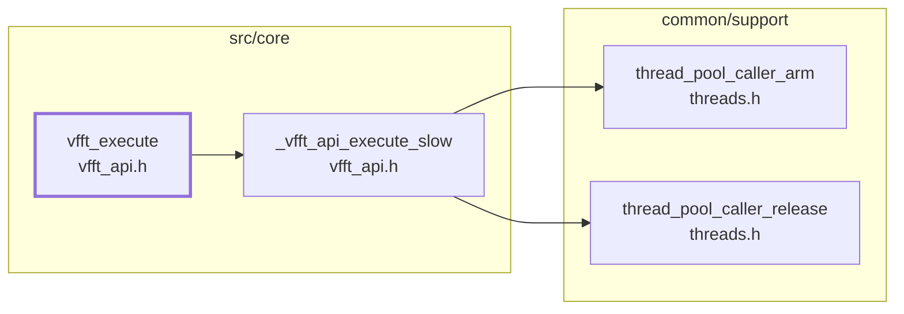

# vfft_execute: the signature check and the layout fork

Generated by `src/tools/archgraph.py`. Do not edit.

What `vfft_execute` (`vfft_api.h`, line 350) calls, 4 levels deep. A solid arrow is a direct call; a
dashed arrow is a function passed or stored by name (a thread-pool task, a dispatch
table entry, a plan's function pointer). `+N` on a node: N more callees not drawn
(see `functions.md`, or run `python src/tools/archgraph.py --calls NAME`).

Shared helpers left out (6 or more callers each): `_vfft_exec6`, `_vfft_tname`, `_vfft_warn`.

Best effort: calls through function pointers and macros are not followed; both
sides of every `#if` are read.
