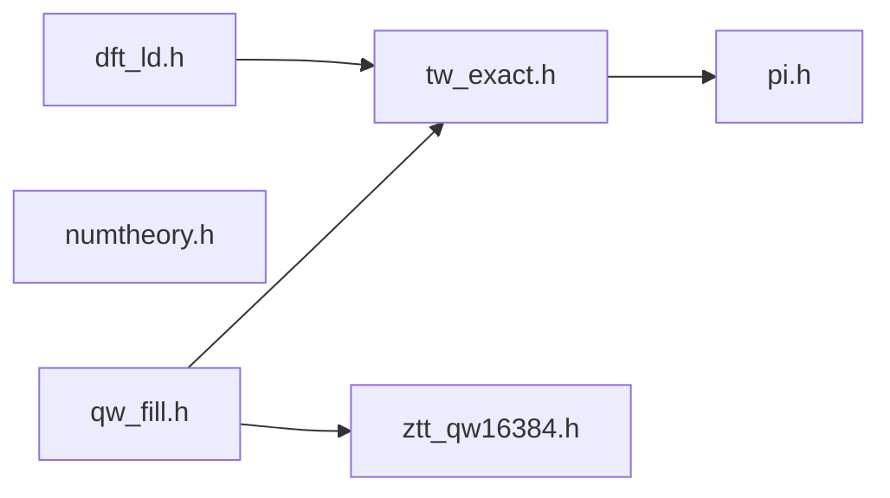

# src/core/common/math

Generated by `src/tools/archgraph.py`. Do not edit. Zone: `common`.

Files of this folder and their includes. Includes of files in other folders are
collapsed to that folder (a rounded node); the full lists are in `../map.md`.

- `dft_ld.h`: THE LONG-DOUBLE DFT OF CREATE TIME (2026-10-17).
- `numtheory.h`: the small integer helpers both prime engines need, once.
- `pi.h`: THE value of pi, once (the utilities merge, 2026-09-27).
- `qw_fill.h`: the ZTURN-T twiddle streams expanded from the BAKED QUARTER-WAVE (ztt_qw16384.h), for either library (common/: split cannot include il/).
- `tw_exact.h`: cos/sin(2*pi*p/n) rounded ONCE to double, from the integers.
- `ztt_qw16384.h`: ZTURN-T's BAKED QUARTER-WAVE: sin(2*pi*k/16384), k = 0..4096, 4097 doubles (32776 B of .rodata), generated by zt_bake_qw.c (hex-float, exact).

