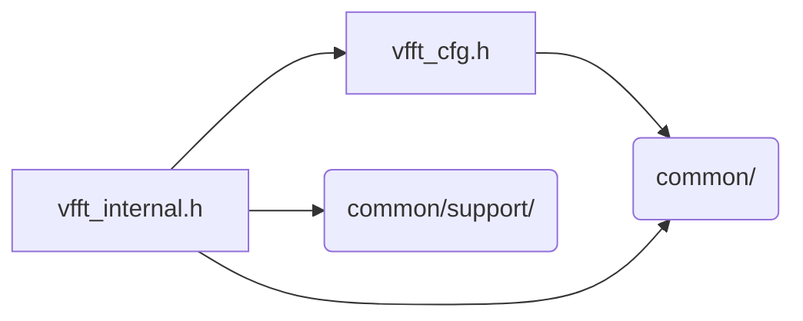

# src/core/common/plan

Generated by `src/tools/archgraph.py`. Do not edit. Zone: `common`.

Files of this folder and their includes. Includes of files in other folders are
collapsed to that folder (a rounded node); the full lists are in `../map.md`.

- `vfft_cfg.h`: THE REQUEST AS THE ENGINES READ IT (2026-10-15, the public API's version 2).
- `vfft_internal.h`: the three private handle types.

