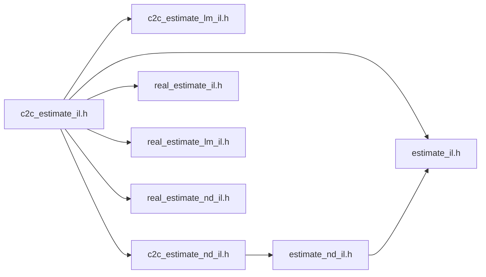

# src/core/il/estimate

Generated by `src/tools/archgraph.py`. Do not edit. Zone: `il`.

Files of this folder and their includes. Includes of files in other folders are
collapsed to that folder (a rounded node); the full lists are in `../map.md`.

- `c2c_estimate_il.h`: the ESTIMATE create (VFFT_FLAG_ESTIMATE): a 1D interleaved c2c plan built from the formulas' recipe (il/estimate/estimate_il.h) through the door's own replay, with nothing measu...
- `c2c_estimate_lm_il.h`: the ESTIMATE create of a LANE-MAJOR c2c batch (VFFT_FLAG_ESTIMATE with VFFT_BATCH_LANE_MAJOR, howmany = K >= 2) at rank 1, 2 and 3: the batch's rows written from the formulas an...
- `c2c_estimate_nd_il.h`: the ESTIMATE create at rank 2 and 3 (VFFT_FLAG_ESTIMATE): a 2D or 3D interleaved c2c plan built from the formulas' recipe (il/estimate/estimate_nd_il.h) through the doors' own r...
- `estimate_il.h`: THE ESTIMATE: the plan of a 1D interleaved c2c transform chosen by formulas, with nothing measured (VFFT_FLAG_ESTIMATE, include/vfft.h).
- `estimate_nd_il.h`: THE ESTIMATE at rank 2 and 3: the plan of a 2D or 3D interleaved c2c transform chosen by formulas, with nothing measured (VFFT_FLAG_ESTIMATE, include/vfft.h; the design: docs/de...
- `real_estimate_il.h`: the ESTIMATE create of a 1D REAL transform (VFFT_FLAG_ESTIMATE on R2C or C2R, rank 1, one transform): the real door's row written from the formulas and replayed by the door with...
- `real_estimate_lm_il.h`: the ESTIMATE create of a LANE-MAJOR REAL batch (VFFT_FLAG_ESTIMATE on R2C or C2R at howmany = K >= 2 in the lane-major geometry: the real batch's DEFAULT at rank 1, named at ran...
- `real_estimate_nd_il.h`: the ESTIMATE create of one 2D real transform (VFFT_FLAG_ESTIMATE; R2C and C2R, natural order, either placement, any thread count): the 2D real door's row written from formulas i...

