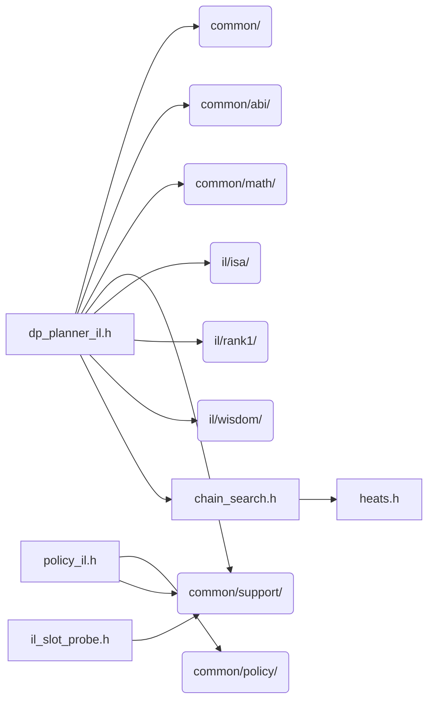

# src/core/il/planning

Generated by `src/tools/archgraph.py`. Do not edit. Zone: `il`.

Files of this folder and their includes. Includes of files in other folders are
collapsed to that folder (a rounded node); the full lists are in `../map.md`.

- `chain_search.h`: the measured CHAIN SEARCH over a radix pool (owner, 2026-10-04): the flat DITs' chain pick, c2c (il/planning/dp_planner_il.h) and real (il/real/odd_build.h, zrf).
- `dp_planner_il.h`: measured plan search for the INTERLEAVED (IL) K=1 axis.
- `heats.h`: the measured TOURNAMENT IN HEATS (owner, 2026-10-04): many candidates ranked by same-run races, never by numbers taken one after another.
- `il_slot_probe.h`: the INTERLEAVED PAIR tier's half of the slot invariant: which slots exist, and how to build and check one.
- `policy_il.h`: THE planning policy: the one place a law about a REQUEST is written (docs/design/planning_policy_design.md).

