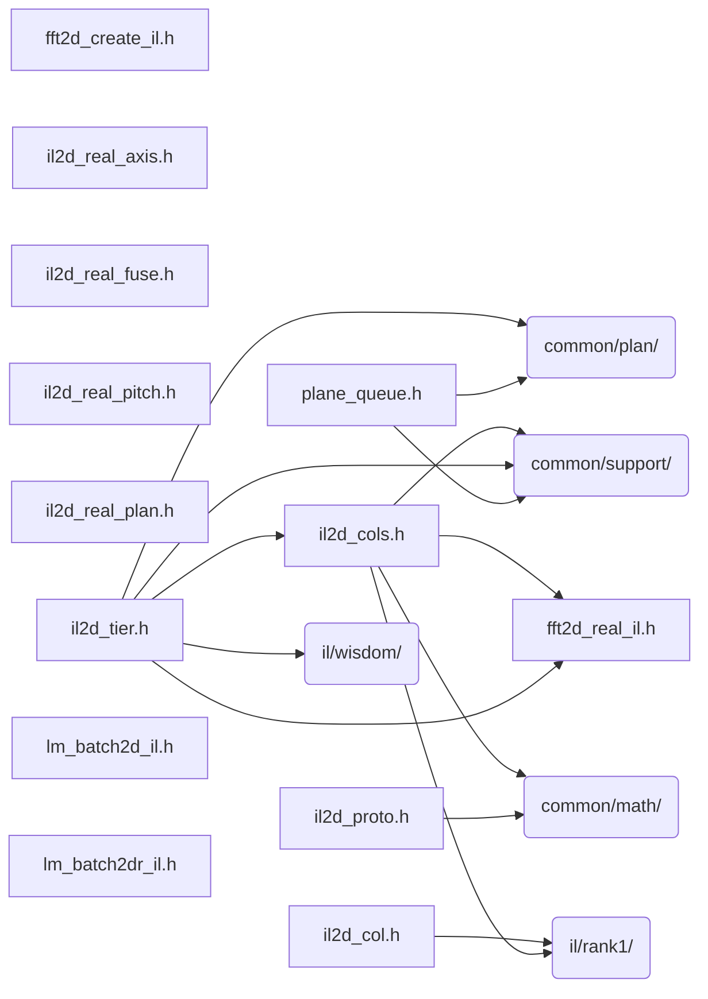

# src/core/il/rank2

Generated by `src/tools/archgraph.py`. Do not edit. Zone: `il`.

Files of this folder and their includes. Includes of files in other folders are
collapsed to that folder (a rounded node); the full lists are in `../map.md`.

- `fft2d_create_il.h`: the rank-2 CREATE, interleaved tier.
- `fft2d_real_il.h`: the native IL 2D REAL tier's execution kernels (docs/roadmap/fft2d_real_il_design.md; the row-pass drivers live in il2d_tier.h — this header holds the kernel-grade data movement...
- `il2d_col.h`: THE COLUMN-AXIS PASS DESCRIPTOR.
- `il2d_cols.h`: native IL 2D: the column-chain machinery.
- `il2d_proto.h`: SCALAR SIMULATOR for the native IL 2D c2c tier's stage maps (docs/roadmap/fft2d_il_c2c_design.md).
- `il2d_real_axis.h`: THE REAL AXIS ON N1 (2026-10-07): a whole-plan FORM of the interleaved 2D r2c plan at an even N1 and an odd N2 (docs/roadmap/il2d_real_axis_n1.md).
- `il2d_real_fuse.h`: THE FUSED WALK (2026-10-07): the interleaved 2D r2c plan's rows fused into column stage 0, the suffix tiled.
- `il2d_real_pitch.h`: THE REAL TIER'S PITCH FORMS (2026-10-07): two planes the caller never sees moved off the CCE pitch hp1, where a one-kernel column pass in place at that pitch aliases itself (16...
- `il2d_real_plan.h`: the 2D real tier's PASS PLANS and their planners, per direction: the ROW PLAN (below) and the COLUMN PLAN (at the end of the file), each the r2c plan and its c2r twin (2026-10-05).
- `il2d_tier.h`: the native interleaved 2D tier.
- `lm_batch2d_il.h`: THE LANE-MAJOR 2D BATCH (docs/roadmap/lane_major_batch_design.md, step 6, 2026-10-15): K >= 2 planes of N1 x N2 side by side, element (r, c) of transform t at z[2 ((r N2 + c) K...
- `lm_batch2dr_il.h`: THE LANE-MAJOR 2D REAL BATCH, r2c and c2r (docs/roadmap/lane_major_batch_design.md, step 6, 2026-10-15): K real planes of N1 x N2 side by side, x[(r N2 + c) K + t]; the spectrum...
- `plane_queue.h`: the 2D plane queue (howmany > 1), and one rank up the VOLUME QUEUE (2026-10-18): the same wrapper over the single-volume rank-3 plan, K contiguous volumes at the per-volume dist...

