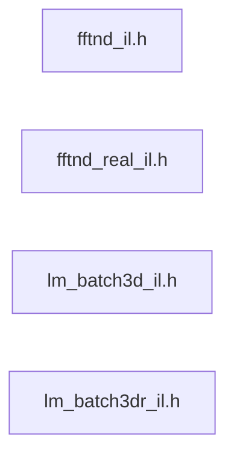

# src/core/il/rank3

Generated by `src/tools/archgraph.py`. Do not edit. Zone: `il`.

Files of this folder and their includes. Includes of files in other folders are
collapsed to that folder (a rounded node); the full lists are in `../map.md`.

- `fftnd_il.h`: the rank-N INTERLEAVED c2c tier (design of record: docs/roadmap/fftnd_il_design.md).
- `fftnd_real_il.h`: the rank-3 INTERLEAVED REAL tier (design of record: docs/roadmap/fft3d_real_il_design.md, decided with the owner 2026-10-07).
- `lm_batch3d_il.h`: THE LANE-MAJOR 3D BATCH (docs/roadmap/lane_major_batch_design.md, step 6, 2026-10-15): K >= 2 volumes of N1 x N2 x N3 side by side, element (i, j, k) of transform t at z[2 ((i N...
- `lm_batch3dr_il.h`: THE LANE-MAJOR 3D REAL BATCH, r2c and c2r (docs/roadmap/lane_major_batch_design.md, step 6 one rank up, 2026-10-19): K real volumes of N1 x N2 x N3 side by side, x[((i N2 + j) N...

