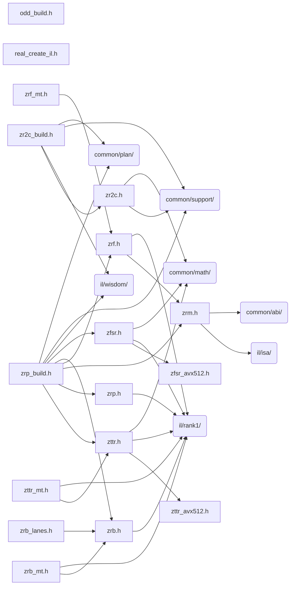

# src/core/il/real

Generated by `src/tools/archgraph.py`. Do not edit. Zone: `il`.

Files of this folder and their includes. Includes of files in other folders are
collapsed to that folder (a rounded node); the full lists are in `../map.md`.

- `odd_build.h`: the real door's ODD-N engine pick (K=1, INTERLEAVED, both placements): env pin, the banked engine, or THE ODD REAL RACE.
- `real_create_il.h`: the r2c / c2r CREATE, interleaved tier.
- `zfsr.h`: the real FOUR-STEP: the 1D real transform above ZTT-r's band on the 1D c2c four-step's recipe (il/rank1/k1_fourstep.h), the Hermitian fold acting on the mirror pairs through the...
- `zfsr_avx512.h`: the real four-step's block gather, scatter and its two order sweeps at 512 bits (the avx512 build).
- `zr2c.h`: INTERLEAVED (z) real-transform folds: the "CCE-mirror IL" route's two hand-written passes (measured −30…−59% vs the K-axis fold).
- `zr2c_build.h`: the interleaved-CCE real route ("kind 5").
- `zrb.h`: the real BLUESTEIN: the odd-N real transform that has no chain (a prime, or a composite with a factor outside the flat DIT's pool) as a chirp-z convolution at length M on the IL...
- `zrb_lanes.h`: the real Bluestein over K LANES: the interleaved real batch in its DEFAULT geometry (lane-major: element e of lane t at x[e K + t], bin f of lane t at z[2 (f K + t)]) at an odd...
- `zrb_mt.h`: the real Bluestein's THREADED form (il/real/zrb.h; owner, 2026-10-03: the convolutions take c2c's threading).
- `zrf.h`: the real FLAT DIT: the odd-N real transform on the c2c flat DIT's own stages (il/rank1/il_flatdit.h), real input never widened to complex.
- `zrf_mt.h`: the real flat DIT's THREADED forms: the c2c flat DIT's tiles arm (il/rank1/il_flatdit_mt.h) on the real engine's levels, in two arms.
- `zrm.h`: the real MONO engine: the whole small real transform as ONE kernel.
- `zrp.h`: the interleaved REAL PAIR (2026-09-29, docs/roadmap/ il_real_engine_research.md, method 1): a real transform of even N = R1 * R2 in two stages, no fold pass — the untangle rides...
- `zrp_build.h`: the real pair's, ZTT-r's and the real mono's handles and the real door's engine race.
- `zttr.h`: ZTURN-T REAL (2026-09-29, docs/roadmap/il_real_engine_research.md method 2): the r2c of an even N on the ZTURN-T machinery at M = N/2 with the Hermitian fold FUSED INTO THE TERM...
- `zttr_avx512.h`: ZTT-r's two fused kernels at 8 lanes (the avx512 build).
- `zttr_mt.h`: ZTT-r's THREADED arms: the ZTT's threaded walk (il/rank1/ ztt_mt.h) with the Hermitian fold staying FUSED.

