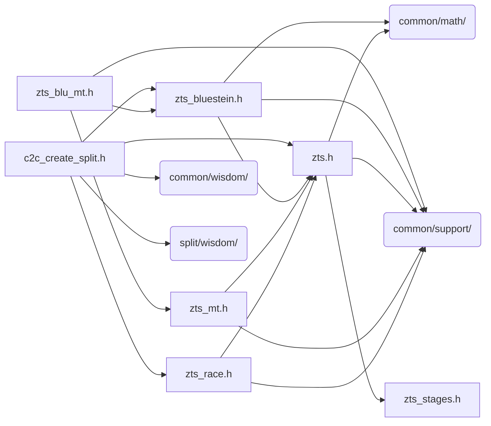

# src/core/split/rank1

Generated by `src/tools/archgraph.py`. Do not edit. Zone: `split`.

Files of this folder and their includes. Includes of files in other folders are
collapsed to that folder (a rounded node); the full lists are in `../map.md`.

- `c2c_create_split.h`: the split library's 1D C2C create: zturn-ts, both placements (docs/design/split_v1_0_contract.md).
- `zts.h`: zturn-ts: ZTURN-T's RUN-CONTIGUOUS DIT engine on the SPLIT layout, 1D c2c, natural order, 16 <= N <= 262144, N = R[0] * ...
- `zts_blu_mt.h`: OUT OF THE BUILD (owner 2026-11-07): the split Bluestein is too weak to refine and release unless customers ask for it.
- `zts_bluestein.h`: OUT OF THE BUILD (owner 2026-11-07): the split Bluestein is too weak to refine and release unless customers ask for it.
- `zts_mt.h`: zturn-ts's SECTIONED walk: the threaded form of ONE transform (ZTURN-T's ztt_mt.h on the split layout, 2026-11-06).
- `zts_race.h`: zturn-ts's create-time race on the shared race body (common/support/race.h): the five parts, docs/design/planning_model.md §4.
- `zts_stages.h`: zturn-ts's STAGE KERNELS, for the staged executor: the cells with no fused driver (every 2^a*odd cell of the odd band, zts.h vfft_zts_odd_band) run one kernel call per stage and...

