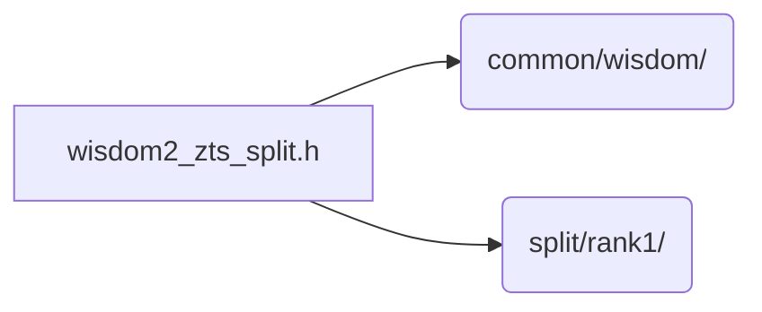

# src/core/split/wisdom

Generated by `src/tools/archgraph.py`. Do not edit. Zone: `split`.

Files of this folder and their includes. Includes of files in other folders are
collapsed to that folder (a rounded node); the full lists are in `../map.md`.

- `wisdom2_zts_split.h`: the SPLIT library's zturn-ts wisdom: the cell rows a split 1D c2c natural-order request is served from, and their codec.

