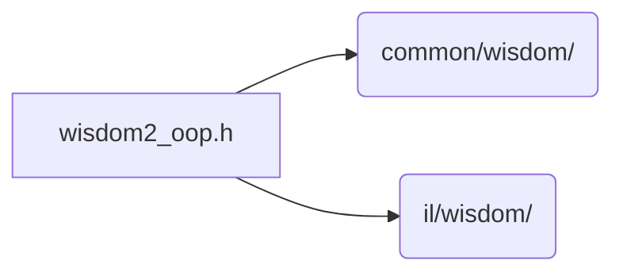

# src/core/wisdom2

Generated by `src/tools/archgraph.py`. Do not edit. Zone: `wisdom2`.

Files of this folder and their includes. Includes of files in other folders are
collapsed to that folder (a rounded node); the full lists are in `../map.md`.

- `wisdom2_oop.h`: the front door's OOP-family wisdom include.

