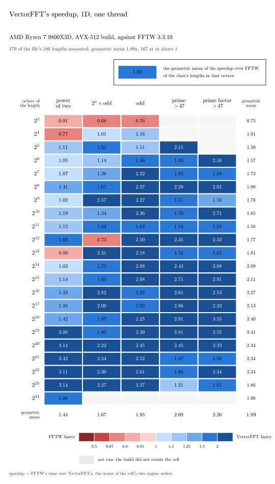
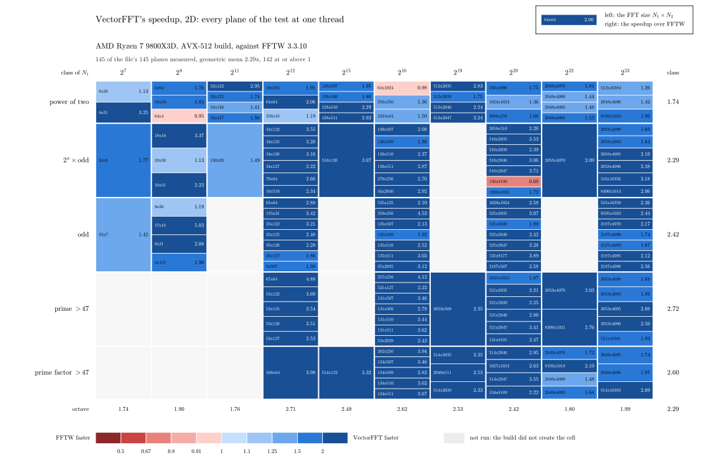
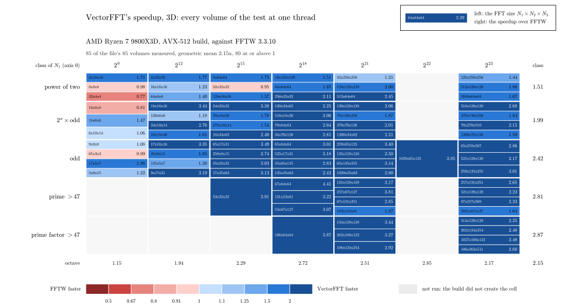

# VectorFFT regression test — FP64, **Ryzen 7 9800X3D**

The regression test's single transforms ([`tests/regression/`](../../tests/regression/README.md)) on an AMD Ryzen 7
9800X3D, AVX-512 build, one thread, against FFTW 3.3.10. Speedup = FFTW's time / VectorFFT's time: above 1 means
VectorFFT is faster.

- [1D](#1d-179-lengths): 179 lengths from 8 to 2^24, geometric mean **1.89×**, ahead on 167 of 179.
- [2D](#2d-145-planes): 145 planes, geometric mean **2.29×**, ahead on 142 of 145.
- [3D](#3d-85-volumes): 85 volumes, geometric mean **2.15×**, ahead on 80 of 85.
- [Threads](#threads): VectorFFT alone at 4 and 8 threads; at 8 threads a transform of 1 to 96 MiB runs 3.9× (1D)
  to 7.3× (2D) faster than at one thread.
- [Lengths with a large prime factor](#1d-lengths-with-a-large-prime-factor-83-lengths): 83 1D lengths from 262,145
  to 6,400,192, geometric mean **2.22×**, ahead on 82 of 83.

The numbers are **not comparable** with other machines' pages.

## The run

| Property | Value |
| --- | --- |
| CPU | AMD Ryzen 7 9800X3D, 8 cores, two threads each |
| Caches | L1d 48 KiB and L2 1 MiB per core, L3 96 MiB shared |
| Library | VectorFFT 0.8.1 at commit 7229967d, built for any AVX-512 CPU (`-mavx512f -mavx512dq -mfma`), GCC 16.2 |
| Plans | the estimate (`VFFT_FLAG_ESTIMATE`): computed from formulas, nothing measured on this machine, no wisdom read |
| Competitor | FFTW 3.3.10, plans made with `FFTW_MEASURE`, one thread; at 4 and 8 threads VectorFFT ran alone |
| Contract | complex-to-complex FP64, interleaved, natural order, out of place, K = 1 |
| Cells | the test's three files: 179 of the 180 lengths (8,388,609 was not created in this build), 145 planes and 85 volumes; and 83 1D lengths with a prime factor above 47 |
| Method | the [gauntlet](../../gauntlet/): each cell timed twice with the engine order flipped, the speedup taken from the **worse** of the two; a control cell (4,096, 64×64 and 64×64×64) re-timed through each run |
| Date | 2026-11-21, the five parts of the AVX-512 test package, about 5½ hours |
| Records | [`regression_1d_avx512_9800x3d_2026-11-21`](../../tests/performance_results/regression_1d_avx512_9800x3d_2026-11-21/), [`regression_2d_avx512_9800x3d_2026-11-21`](../../tests/performance_results/regression_2d_avx512_9800x3d_2026-11-21/), [`regression_3d_avx512_9800x3d_2026-11-21`](../../tests/performance_results/regression_3d_avx512_9800x3d_2026-11-21/), [`prime_sides_1d_avx512_9800x3d_2026-11-21`](../../tests/performance_results/prime_sides_1d_avx512_9800x3d_2026-11-21/) |

## Reading the figures

Each figure has a row per class of the test's cells and a column per octave of the length, plane or volume. A square
holds one block per cell, coloured by that cell's speedup over FFTW: blue where VectorFFT is faster, red where FFTW
is. The key at the top right says what a block prints. A grey block is a cell the build did not create. Right of a
row is the class's geometric mean, under a column the octave's. The figures are drawn by
[`src/tools/plots/gen_regression_grid.py`](../../src/tools/plots/gen_regression_grid.py) from the records' csv files.

The classes are the test's: a power of two; 2^a × odd and odd, every prime factor at most 47; a prime above 47; a
composite with a prime factor above 47. 1D takes the length's class, 2D and 3D the class of N1. The line is at 47
because 47 is the largest prime VectorFFT has its own kernel for: a length whose prime factors are all 47 or below
is built from those kernels, and a prime of 53 or more goes through Rader's or Bluestein's method. A prime of 47 or
below, such as 17 or 31, is in the odd row.

## 1D, 179 lengths

| Class | Lengths | Geometric mean |
| --- | ---: | ---: |
| Power of two | 22 | **1.44×** |
| 2^a × odd | 42 | **1.67×** |
| Odd | 42 | **1.95×** |
| Prime above 47 | 38 | **2.09×** |
| Prime factor above 47 | 35 | **2.26×** |
| **All** | **179** | **1.89×** |

- **Ahead on 167 of the 179 lengths**; 126 read 1.5× or more and 81 read 2× or more.
- **Highest:** 516 = 2² × 3 × 43 (4.46×), the prime 262,139 (4.30×), 16,356 (4.13×) and 8,177 (4.12×). The powers of
  two from 2^19 to 2^22 read 3.08× to 3.41×.
- **Behind on 12:** the short lengths 8 to 16 (0.65× to 0.91×), 35 (0.99×) and 70 (0.93×); 8,192 (0.90×), 1,200
  (0.80×) and 33,614 = 2 × 7^5 (0.81×); and 8,190 = 2 × 3² × 5 × 7 × 13 at **0.38×** (37.7 µs against FFTW's
  16.2 µs), the lowest cell of the run.
- **Accuracy:** VectorFFT's output agrees with FFTW's to 2.7e-15 or better, except the two largest primes, 8,388,617
  (2.0e-14) and 16,777,213 (1.9e-14).
- **Noise:** the control cell, 4,096, read 1.33× to 1.71× through the run, so a single 1D length is less certain
  than one of 2D or 3D.

## 2D, 145 planes

| Class of N1 | Planes | Geometric mean |
| --- | ---: | ---: |
| Power of two | 33 | **1.74×** |
| 2^a × odd | 32 | **2.29×** |
| Odd | 33 | **2.42×** |
| Prime above 47 | 26 | **2.72×** |
| Prime factor above 47 | 21 | **2.60×** |
| **All** | **145** | **2.29×** |

- **Ahead on 142 of the 145 planes**; 127 read 1.5× or more and 94 read 2× or more.
- **Highest:** 17×16 (5.03×), 67×64 (4.88×), 259×256 (4.53×) and 257×256 (4.12×).
- **Behind on 3:** 130×8,190 (0.69×), whose N2 is the 1D outlier 8,190, 64×4 (0.95×) and 64×1,024 (0.98×).
- **Accuracy:** to 6.1e-15 or better. **Noise:** the control cell, 64×64, read 2.05× to 2.22×.

## 3D, 85 volumes

| Class of N1 | Volumes | Geometric mean |
| --- | ---: | ---: |
| Power of two | 18 | **1.51×** |
| 2^a × odd | 23 | **1.99×** |
| Odd | 24 | **2.42×** |
| Prime above 47 | 12 | **2.81×** |
| Prime factor above 47 | 8 | **2.87×** |
| **All** | **85** | **2.15×** |

- **Ahead on 80 of the 85 volumes**; 70 read 1.5× or more and 51 read 2× or more.
- **Highest:** 67×64×64 (4.41×), 53×32×32 (3.91×), 106×64×64 (3.87×) and 257×67×127 (3.81×).
- **Behind on 5, all small:** 32×4×4 (0.77×), 10×8×8 (0.81×), 32×32×32 (0.95×), 8×8×8 (0.98×) and 65×3×3 (0.99×).
  The volumes up to 48 KiB read 1.15× as a group; above 4,096 points every volume is ahead except 32×32×32.
- **Accuracy:** to 3.4e-15 or better. **Noise:** the control cell, 64×64×64, read 2.22× to 2.29×.

## Threads

The same cells at 4 and 8 threads, VectorFFT alone (FFTW's plans with threads took minutes a size, so it ran at one
thread only). Each figure is VectorFFT's speedup over its own one-thread time, by one transform's bytes (16 times
its points) against the caches; the one-thread speedup over FFTW is beside it.

| Rank | One transform | Cells | Over FFTW, one thread | 4 threads over 1 | 8 threads over 1 |
| --- | --- | ---: | ---: | ---: | ---: |
| 1D | up to 48 KiB | 67 | 1.54× | 1.13× | 1.11× |
|  | 48 KiB to 1 MiB | 41 | 1.91× | 1.86× | 2.20× |
|  | 1 to 96 MiB | 58 | 2.32× | 2.80× | 3.91× |
|  | past 96 MiB | 13 | 2.12× | 2.16× | 2.35× |
| 2D | up to 48 KiB | 14 | 1.86× | 1.10× | 1.11× |
|  | 48 KiB to 1 MiB | 36 | 2.36× | 2.70× | 3.72× |
|  | 1 to 96 MiB | 60 | 2.61× | 4.10× | 7.28× |
|  | past 96 MiB | 35 | 1.93× | 3.02× | 4.13× |
| 3D | up to 48 KiB | 10 | 1.15× | 1.16× | 1.16× |
|  | 48 KiB to 1 MiB | 23 | 2.11× | 2.70× | 3.44× |
|  | 1 to 96 MiB | 33 | 2.61× | 3.78× | 6.79× |
|  | past 96 MiB | 19 | 2.20× | 2.89× | 3.72× |

- **Largest gains** where a transform fits the 96 MiB L3: 7.28× in 2D and 6.79× in 3D at 8 threads. Past the L3 the
  gain drops to 2.35× (1D) to 4.13× (2D).
- **Small transforms** up to 48 KiB gain little from threads, 1.10× to 1.16×.
- **No transform past 65,536 points ran slower with threads** than with one.
- **Accuracy:** with no competitor the column is VectorFFT's own round trip, 2.9e-14 or better.

## 1D lengths with a large prime factor, 83 lengths

83 1D lengths from 262,145 to 6,400,192, each with a prime factor above 47, listed in the record's `cells.txt`:
the lengths VectorFFT's four-step with a prime-sized side serves. The estimate takes the four-step (route `fs`) at 71
of them and one chain of kernels with a Rader stage (route `flat`) at the other 12, the same route at 1, 4 and 8
threads. FFTW at one thread; at 4 and 8 threads VectorFFT ran alone, its speedup over its own one-thread time.

| Lengths | Cells | Geometric mean | Median | Ahead | 4 threads over 1 | 8 threads over 1 |
| --- | ---: | ---: | ---: | ---: | ---: | ---: |
| 262,145 to 524,287 | 15 | **2.25×** | 2.21× | 15 | 3.30× | 4.68× |
| 524,288 to 2,097,151 | 36 | **2.40×** | 2.53× | 35 | 3.31× | 5.06× |
| 2,097,152 to 6,400,192 | 32 | **2.03×** | 1.96× | 32 | 3.07× | 3.93× |
| **All** | **83** | **2.22×** | 2.22× | **82** | 3.21× | 4.53× |

- **Ahead on 82 of the 83 lengths**; 75 read 1.5× or more and 52 read 2× or more. The only loss is 524,310 =
  2 × 3 × 5 × 17,477 (0.96×).
- **Highest:** 262,145 = 5 × 13 × 37 × 109 (3.70×), 524,305 = 5 × 19 × 5,519 (3.61×) and 1,049,322 =
  2 × 3 × 47 × 61² (3.59×).
- **Lowest of the rest:** 1,048,626 = 2 × 3⁴ × 6,473 (1.36×), 2,097,901 = 13 × 161,377 (1.39×), 4,195,802 and
  1,049,130 (1.42×).
- **Threads:** the weakest gain at 8 threads is 4,194,365 = 5 × 7 × 119,839 (1.47×), the strongest 8.13×.
- **Accuracy:** at one thread VectorFFT's output agrees with FFTW's to 5.7e-15 or better. At 4 and 8 threads the
  round trip is 1.1e-14 or better on the four-step and 2.8e-14 at most (2,097,901, route `flat`).
- **Noise:** the control cell, 4,096, read 1.37× to 2.07× at one thread, so a single length here is less certain
  than the table's groups.
