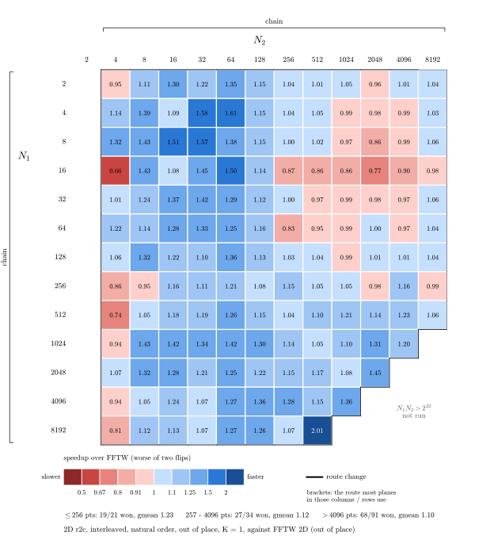
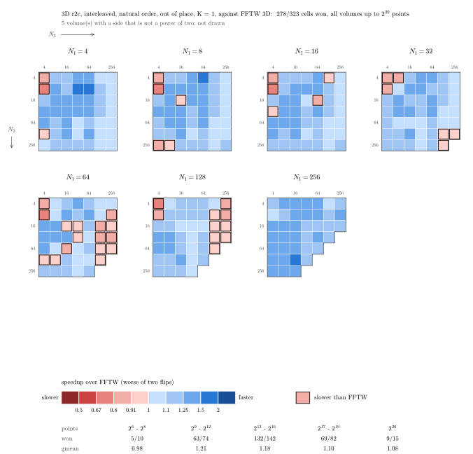

# VectorFFT vs FFTW

VectorFFT against [FFTW](https://www.fftw.org/), the real-input transforms in 2D and 3D. Each
section is one contract: a speedup matrix, a short reading of it, and the speedups by size band.
Every run is a [gauntlet](../../gauntlet/) record under
[`gauntlet/results/`](../../gauntlet/results/) (csv, calibration log, the wisdom it used, FFTW's
own wisdom). The 2D matrix is drawn from the run's report by
[`src/tools/plots/gen_2d_pow2.py`](../../src/tools/plots/gen_2d_pow2.py), the 3D matrices from the
csv by [`src/tools/plots/gen_3d_pow2.py`](../../src/tools/plots/gen_3d_pow2.py).

> **Platform:** Intel Core i9-14900KF (P-core, AVX2), DDR5, GCC 15.2, single thread  
> **Competitor:** FFTW 3.3.10, the vcpkg build with its AVX and AVX2 code paths; plans made with FFTW_MEASURE, each run keeping its own FFTW wisdom  
> **Method:** one process per cell (a plane or a volume); both engines timed in two arms with the
> engine order flipped; a control cell re-timed every 100 cells; every speedup is FFTW's time over
> VectorFFT's in the **worse** of the two arms

---

## 2D r2c, every power-of-two plane up to 4M points

> **Contract:** 2D real-to-complex FP64, N1 x N2 reals in, the N1 x (N2/2 + 1) CCE bins out, interleaved, out of place, K = 1  
> **Cells:** every plane N1 x N2 with each side a power of two from 2 to 8,192 and at most 2^22 points: 146 planes; the 13 planes with N2 = 2 are refused by VectorFFT's 2D r2c and not timed  
> **Record:** [`vsfftw_2d_r2c`](../../gauntlet/results/vsfftw_2d_r2c/) (2026-10-11), every plane raced at create in the run's own store

One cell per plane, the speedup over FFTW in the worse of the two engine orders. VectorFFT is
ahead at 112 of the 146 planes, median 1.11x, geomean 1.12x. FFTW leads in both engine orders at
24 planes, almost all of them thin: a last axis of 4 (512x4 0.74x, 8192x4 0.81x, 256x4 0.86x) or
N1 = 16 with a long N2 (16x2048 0.77x, 16x512 and 16x1024 0.86x); at the other 10 planes behind,
only one of the two orders came out slower. Every output agrees with FFTW's to 5.6e-16; the
control plane (64x64) read 1.21-1.29x.

| Plane size | Cells | Median speedup | At or above parity | Best |
|---|---|---|---|---|
| up to 256 points | 21 | 1.24x | 90% | 1.61x (4x64) |
| 257..4,096 | 34 | 1.11x | 79% | 1.50x (16x64) |
| 4,097..65,536 | 46 | 1.05x | 61% | 1.43x (1024x8) |
| 65,537..4M | 45 | 1.10x | 84% | 2.01x (8192x512) |
| **all, 146 planes** | **146** | **1.11x** | **77%** | 2.01x (8192x512) |

---

## 3D r2c, every power-of-two volume from 4 to 256 per side

> **Contract:** 3D real-to-complex FP64, N1 x N2 x N3 reals in, the N1 x N2 x (N3/2 + 1) CCE bins out, interleaved, out of place, K = 1  
> **Cells:** every volume N1 x N2 x N3 with each side a power of two from 4 to 256 and at most 2^20 points (323 volumes), and five volumes with sides that are not powers of two (27x9x15, 36x20x28, 32x32x27, 64x64x15, 16x64x63): 328 volumes  
> **Record:** [`vsfftw_3d_r2c`](../../gauntlet/results/vsfftw_3d_r2c/) (2026-10-11), every volume's plan replayed from the shipped wisdom

One matrix per N1; each cell is the speedup over FFTW in the worse of the two engine orders, and a
cell slower than FFTW is outlined (the five volumes with odd sides are not on the matrices).
VectorFFT is ahead at 281 of the 328 volumes, median 1.16x, geomean 1.15x. FFTW leads in both
engine orders at 32 volumes: 13 whose last two sides are both 4 or 8 (0.72-0.88x), 15 larger
volumes with N1 = 64 or 128 (0.81-0.98x) and 4 others; at the other 15 volumes behind, only one of
the two orders came out slower. Of the volumes with odd sides, three are ahead (16x64x63 1.47x,
32x32x27 1.41x, 36x20x28 1.07x) and two behind (27x9x15 0.95x, 64x64x15 0.81x). Every output
agrees with FFTW's to 5.7e-16; the control volume (64x64x64) read 1.09-1.19x.

| Volume | Cells | Median speedup | At or above parity | Best |
|---|---|---|---|---|
| up to 4,096 points | 84 | 1.23x | 81% | 1.52x (4x8x32) |
| 4,097..65,536 | 142 | 1.18x | 93% | 1.50x (256x4x64) |
| 65,537..1M | 97 | 1.10x | 80% | 1.51x (256x128x16) |
| **all power-of-two, 323 volumes** | **323** | **1.16x** | **86%** | 1.52x (4x8x32) |
