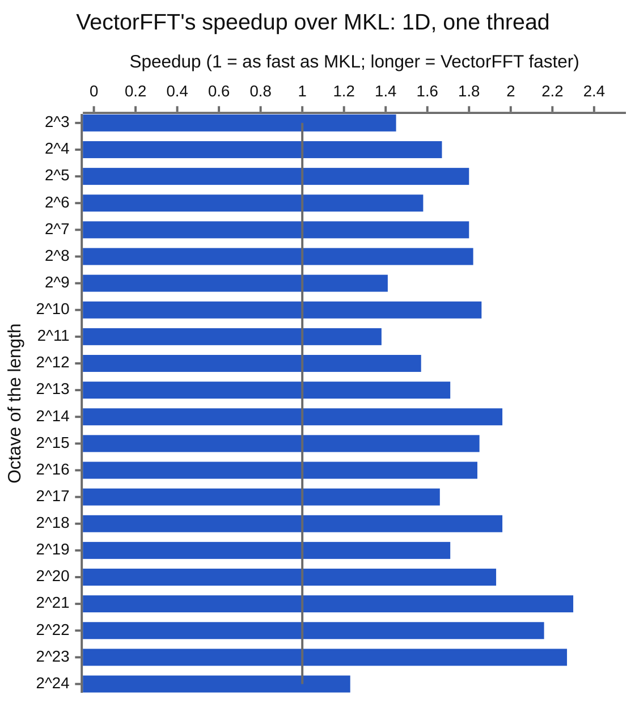
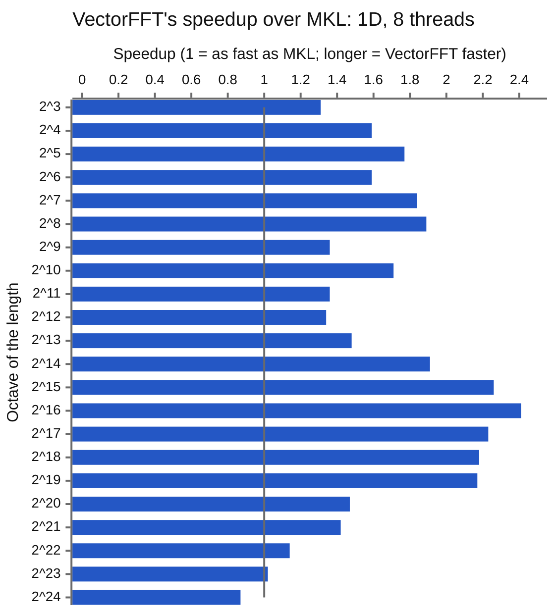
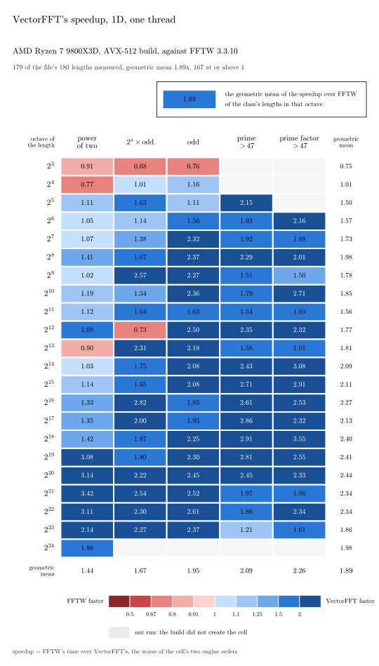
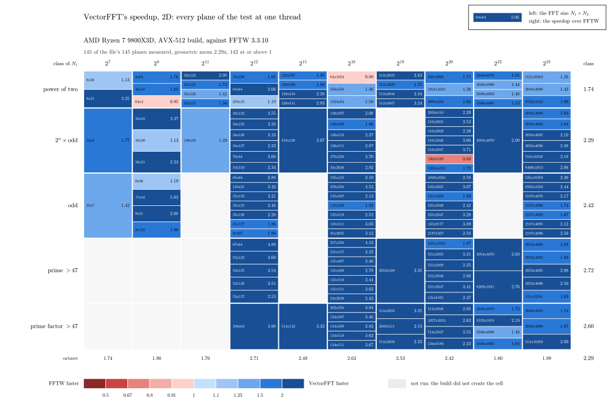
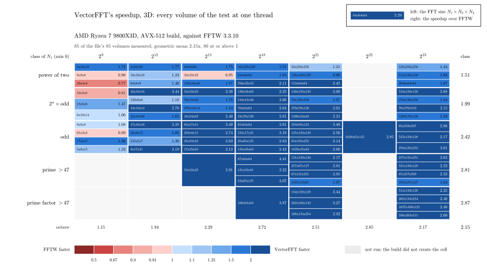

# Performance results

The regression test's runs ([`tests/regression/`](../regression/README.md)), one folder per cell file, instruction set
and date. The folders without a machine in their name come from an Intel Core i9-14900KF (L1d 48 KiB and L2 2 MiB per
P-core, L3 36 MiB), which has no AVX-512 and so runs the AVX2 build alone; the `_9800x3d` folders come from an AMD
Ryzen 7 9800X3D running the AVX-512 build (the last section). Every plan is the estimate's (`VFFT_FLAG_ESTIMATE`); the
planner's runs are not in the folder.

Every speedup on this page is VectorFFT's speedup over its section's competitor (MKL on the 14900KF, FFTW on the
9800X3D), the competitor's time divided by VectorFFT's: 2.00x means VectorFFT runs in half of the competitor's time,
and a figure below 1.00x means the competitor is faster. Only the thread columns of Table 8 compare VectorFFT with
itself. A cell takes the worse of its two engine orders. Each folder holds the gauntlet's csv and report of each run in it (`gauntlet_mt4_est.csv` and
`report_mt4_est.md` at 4 threads, `gauntlet_2d_k8_lm_est.csv` for a lane-major batch of 8 planes, and so on).

## Single transforms at 1, 4 and 8 threads

> **Competitor:** Intel oneMKL 2025.3, at the same thread count  
> **Records:** [`regression_1d_avx2_2026-11-20`](regression_1d_avx2_2026-11-20/),
> [`regression_2d_avx2_2026-11-20`](regression_2d_avx2_2026-11-20/),
> [`regression_3d_avx2_2026-11-20`](regression_3d_avx2_2026-11-20/) (2026-11-20, the library of commit 7bd8a7c6)  
> **Contract:** complex-to-complex FP64, interleaved, natural order, out of place, K = 1  
> **Cells:** the test's three files: 180 lengths from 8 to 2^24, 145 planes and 85 volumes  
> **Method:** both engines timed in two arms with the engine order flipped; a control cell (4,096, 64 x 64 and
> 64 x 64 x 64) re-timed through each run, its readings in the folder's `control*.csv`

The two libraries' outputs differ by at most 6.0e-15, relative to the largest value of MKL's output. 1D has 176 of the
180 lengths: 8,388,609, 8,388,617, 16,777,213 and 16,777,215 were not created in this build.

**Table 1.** By rank and thread count.

| Rank | Threads | Cells | Geomean speedup | Median speedup | At or above parity |
|---|---|---|---|---|---|
| 1D | 1 | 176 | 1.77x | 1.60x | 94% |
|  | 4 | 176 | 1.73x | 1.58x | 92% |
|  | 8 | 176 | 1.66x | 1.50x | 86% |
| 2D | 1 | 145 | 1.70x | 1.61x | 93% |
|  | 4 | 145 | 1.49x | 1.45x | 83% |
|  | 8 | 145 | 1.46x | 1.38x | 85% |
| 3D | 1 | 85 | 2.07x | 2.03x | 99% |
|  | 4 | 85 | 1.68x | 1.40x | 85% |
|  | 8 | 85 | 1.74x | 1.44x | 91% |

**Figure 1.** VectorFFT's speedup over MKL in 1D at one thread, by the octave of the length: each bar is the geometric
mean over the lengths from 2^k up to 2^(k+1) (16,777,216 alone at 2^24). The grey line at 1 is the same speed; a bar
that ends right of it means VectorFFT is faster.

**Figure 2.** VectorFFT's speedup over MKL in 1D at 8 threads, read as Figure 1.

The values of Figures 1 and 2

| Octave | Lengths | One thread | 8 threads |
|---|---|---|---|
| 2^3 | 5 | 1.45x | 1.31x |
| 2^4 | 5 | 1.67x | 1.59x |
| 2^5 | 7 | 1.80x | 1.77x |
| 2^6 | 9 | 1.58x | 1.59x |
| 2^7 | 9 | 1.80x | 1.84x |
| 2^8 | 9 | 1.82x | 1.89x |
| 2^9 | 9 | 1.41x | 1.36x |
| 2^10 | 9 | 1.86x | 1.71x |
| 2^11 | 9 | 1.38x | 1.36x |
| 2^12 | 9 | 1.57x | 1.34x |
| 2^13 | 9 | 1.71x | 1.48x |
| 2^14 | 9 | 1.96x | 1.91x |
| 2^15 | 9 | 1.85x | 2.26x |
| 2^16 | 9 | 1.84x | 2.41x |
| 2^17 | 9 | 1.66x | 2.23x |
| 2^18 | 9 | 1.96x | 2.18x |
| 2^19 | 9 | 1.71x | 2.17x |
| 2^20 | 9 | 1.93x | 1.47x |
| 2^21 | 9 | 2.30x | 1.42x |
| 2^22 | 9 | 2.16x | 1.14x |
| 2^23 | 5 | 2.27x | 1.02x |
| 2^24 | 1 | 1.23x | 0.87x |

**Table 2.** By class, geomean speedup (cells). The classes are the test's: a power of two; 2^a × odd and odd, every prime
factor at most 47; a prime above 47; a composite with a prime factor above 47. 1D takes the length's class, 2D and 3D
the class of N1.

| Rank | Class | One thread | 4 threads | 8 threads |
|---|---|---|---|---|
| 1D | Power of two | 1.21x (22) | 1.34x (22) | 1.27x (22) |
|  | 2^a × odd | 1.75x (42) | 1.54x (42) | 1.35x (42) |
|  | Odd | 1.81x (42) | 1.47x (42) | 1.37x (42) |
|  | Prime above 47 | 1.70x (36) | 2.85x (36) | 3.29x (36) |
|  | Prime factor above 47 | 2.35x (34) | 1.70x (34) | 1.58x (34) |
| 2D | Power of two | 1.50x (33) | 1.39x (33) | 1.34x (33) |
|  | 2^a × odd | 1.47x (32) | 1.18x (32) | 1.20x (32) |
|  | Odd | 1.52x (33) | 1.31x (33) | 1.38x (33) |
|  | Prime above 47 | 2.11x (26) | 1.89x (26) | 1.73x (26) |
|  | Prime factor above 47 | 2.35x (21) | 2.14x (21) | 2.03x (21) |
| 3D | Power of two | 1.76x (18) | 1.44x (18) | 1.54x (18) |
|  | 2^a × odd | 1.77x (23) | 1.37x (23) | 1.44x (23) |
|  | Odd | 2.07x (24) | 1.59x (24) | 1.78x (24) |
|  | Prime above 47 | 2.78x (12) | 2.51x (12) | 2.29x (12) |
|  | Prime factor above 47 | 2.97x (8) | 2.75x (8) | 2.43x (8) |

**Table 3.** By one transform's bytes (16 times its points) against the caches (L1d 48 KiB, L2 2 MiB, L3 36 MiB),
geomean speedup (cells).

| Rank | One transform | One thread | 4 threads | 8 threads |
|---|---|---|---|---|
| 1D | up to 48 KiB | 1.64x (67) | 1.58x (67) | 1.60x (67) |
|  | 48 KiB to 2 MiB | 1.74x (50) | 1.87x (50) | 1.80x (50) |
|  | 2 to 36 MiB | 1.90x (40) | 2.05x (40) | 1.98x (40) |
|  | past 36 MiB | 2.13x (19) | 1.35x (19) | 1.07x (19) |
| 2D | up to 48 KiB | 1.74x (14) | 1.87x (14) | 1.94x (14) |
|  | 48 KiB to 2 MiB | 1.67x (61) | 1.30x (61) | 1.38x (61) |
|  | 2 to 36 MiB | 1.88x (35) | 1.81x (35) | 1.71x (35) |
|  | past 36 MiB | 1.55x (35) | 1.42x (35) | 1.25x (35) |
| 3D | up to 48 KiB | 4.51x (10) | 4.12x (10) | 5.16x (10) |
|  | 48 KiB to 2 MiB | 1.96x (23) | 1.21x (23) | 1.48x (23) |
|  | 2 to 36 MiB | 1.68x (28) | 1.55x (28) | 1.48x (28) |
|  | past 36 MiB | 2.01x (24) | 1.74x (24) | 1.57x (24) |

## Batches of 4 and 8 transforms at one thread

> **Competitor:** Intel oneMKL 2025.3, one thread, on the same layout  
> **Records:** [`regression_1d_avx2_2026-11-21`](regression_1d_avx2_2026-11-21/),
> [`regression_2d_avx2_2026-11-21`](regression_2d_avx2_2026-11-21/),
> [`regression_3d_avx2_2026-11-21`](regression_3d_avx2_2026-11-21/) (2026-11-21, the library of commit 3bafb6bb)  
> **Contract:** complex-to-complex FP64, interleaved, natural order, out of place, a batch of K = 4 or 8 transforms,
> one thread; contiguous (one transform after the other) or lane-major (element i of transform t at position i K + t)  
> **Cells:** the test's three files, every cell whose K transforms fit in 2^24 points  
> **Method:** as above; the lane-major batches against MKL on the same lane-major layout (`ratio_mirror`)

Against MKL's batch on the contiguous layout instead (`ratio_home`), the lane-major batches read 1.63x to 1.94x at the
geometric mean. The two libraries' outputs differ by at most 4.1e-15 in the contiguous batches and 2.8e-14 in the
lane-major ones.

**Table 4.** By layout, rank and K.

| Layout | Rank | K | Batches | Geomean speedup | Median speedup | At or above parity |
|---|---|---|---|---|---|---|
| Contiguous | 1D | 4 | 162 | 1.72x | 1.53x | 90% |
|  |  | 8 | 153 | 1.68x | 1.53x | 90% |
|  | 2D | 4 | 110 | 1.78x | 1.70x | 92% |
|  |  | 8 | 110 | 1.78x | 1.70x | 91% |
|  | 3D | 4 | 66 | 2.02x | 1.82x | 98% |
|  |  | 8 | 51 | 2.05x | 1.80x | 100% |
| Lane-major | 1D | 4 | 162 | 1.77x | 1.81x | 83% |
|  |  | 8 | 153 | 1.89x | 1.77x | 86% |
|  | 2D | 4 | 110 | 2.32x | 2.12x | 97% |
|  |  | 8 | 110 | 2.13x | 2.12x | 96% |
|  | 3D | 4 | 66 | 3.90x | 3.45x | 100% |
|  |  | 8 | 51 | 5.46x | 5.26x | 100% |

**Table 5.** By class (as in Table 2), geomean speedup (batches).

| Rank | Class | Contiguous, K = 4 | Contiguous, K = 8 | Lane-major, K = 4 | Lane-major, K = 8 |
|---|---|---|---|---|---|
| 1D | Power of two | 1.07x (20) | 1.04x (19) | 1.03x (20) | 1.14x (19) |
|  | 2^a × odd | 1.62x (38) | 1.57x (36) | 1.56x (38) | 1.64x (36) |
|  | Odd | 1.67x (38) | 1.64x (36) | 1.76x (38) | 1.81x (36) |
|  | Prime above 47 | 1.74x (34) | 1.73x (32) | 1.79x (34) | 1.92x (32) |
|  | Prime factor above 47 | 2.55x (32) | 2.45x (30) | 2.89x (32) | 3.16x (30) |
| 2D | Power of two | 1.63x (26) | 1.61x (26) | 2.17x (26) | 1.88x (26) |
|  | 2^a × odd | 1.52x (25) | 1.54x (25) | 2.27x (25) | 2.08x (25) |
|  | Odd | 1.57x (26) | 1.58x (26) | 2.30x (26) | 2.07x (26) |
|  | Prime above 47 | 2.12x (19) | 2.11x (19) | 2.27x (19) | 2.29x (19) |
|  | Prime factor above 47 | 2.78x (14) | 2.76x (14) | 2.81x (14) | 2.68x (14) |
| 3D | Power of two | 1.74x (15) | 1.74x (15) | 4.27x (15) | 5.81x (15) |
|  | 2^a × odd | 1.80x (19) | 1.95x (15) | 3.68x (19) | 5.16x (15) |
|  | Odd | 2.13x (20) | 2.29x (16) | 4.16x (20) | 5.79x (16) |
|  | Prime above 47 | 2.80x (8) | 3.05x (4) | 3.43x (8) | 4.57x (4) |
|  | Prime factor above 47 | 2.55x (4) | 1.86x (1) | 3.51x (4) | 3.87x (1) |

## Single transforms on an AMD Ryzen 7 9800X3D (AVX-512)

> **Competitor:** FFTW 3.3.10 (`FFTW_MEASURE`) at one thread; at 4 and 8 threads VectorFFT ran alone  
> **Records:** [`regression_1d_avx512_9800x3d_2026-11-21`](regression_1d_avx512_9800x3d_2026-11-21/),
> [`regression_2d_avx512_9800x3d_2026-11-21`](regression_2d_avx512_9800x3d_2026-11-21/),
> [`regression_3d_avx512_9800x3d_2026-11-21`](regression_3d_avx512_9800x3d_2026-11-21/) (2026-11-21, the library of
> commit 7229967d built for any AVX-512 CPU, `-mavx512f -mavx512dq -mfma`); each folder also holds the machine's
> `machine.txt` and the run's `parts.log`. A fourth folder,
> [`prime_sides_1d_avx512_9800x3d_2026-11-21`](prime_sides_1d_avx512_9800x3d_2026-11-21/), holds the same run's 83
> 1D lengths with a prime factor above 47, read in
> [`docs/performance/regression_FP64_9800X3D.md`](../../docs/performance/regression_FP64_9800X3D.md)  
> **Machine:** AMD Ryzen 7 9800X3D, 8 cores, L1d 48 KiB and L2 1 MiB per core, L3 96 MiB  
> **Contract:** complex-to-complex FP64, interleaved, natural order, out of place, K = 1  
> **Cells:** the test's three files: 179 of the 180 lengths, 145 planes and 85 volumes  
> **Method:** as above, with FFTW in MKL's place; at 4 and 8 threads a cell's two readings are VectorFFT's alone

At one thread VectorFFT's output and FFTW's differ by at most 6.1e-15, relative to the largest value of FFTW's output,
except the 1D lengths 8,388,617 and 16,777,213 at 2.0e-14 and 1.9e-14. At 4 and 8 threads, with no competitor, the
column is VectorFFT's round trip, at most 2.9e-14. The length 8,388,609 was not created in this build. FFTW is faster
at the 1D lengths up to 16 (0.65x to 0.91x), at 8,190 (0.38x) and at a few small volumes (32 x 4 x 4 at 0.77x). The
1D control cell read 1.33x to 1.71x through its run, so a single 1D cell is less certain than one of 2D (2.05x to
2.22x) or 3D (2.22x to 2.29x).

**Table 6.** By rank, one thread, against FFTW.

| Rank | Cells | Geomean speedup | Median speedup | At or above parity |
|---|---|---|---|---|
| 1D | 179 | 1.89x | 1.89x | 93% |
| 2D | 145 | 2.29x | 2.28x | 98% |
| 3D | 85 | 2.15x | 2.25x | 94% |

**Table 7.** By class (as in Table 2), one thread, geomean speedup over FFTW (cells).

| Rank | Power of two | 2^a × odd | Odd | Prime above 47 | Prime factor above 47 |
|---|---|---|---|---|---|
| 1D | 1.44x (22) | 1.67x (42) | 1.95x (42) | 2.09x (38) | 2.26x (35) |
| 2D | 1.74x (33) | 2.29x (32) | 2.42x (33) | 2.72x (26) | 2.60x (21) |
| 3D | 1.51x (18) | 1.99x (23) | 2.42x (24) | 2.81x (12) | 2.87x (8) |

**Table 8.** By one transform's bytes (16 times its points) against the caches (L1d 48 KiB, L2 1 MiB, L3 96 MiB):
the geomean speedup over FFTW at one thread (cells), then VectorFFT's own speedup at 4 and 8 threads over its
one-thread time, each run taking the faster of its two readings.

| Rank | One transform | Over FFTW, one thread | VectorFFT, 4 threads over 1 | VectorFFT, 8 threads over 1 |
|---|---|---|---|---|
| 1D | up to 48 KiB | 1.54x (67) | 1.13x | 1.11x |
|  | 48 KiB to 1 MiB | 1.91x (41) | 1.86x | 2.20x |
|  | 1 to 96 MiB | 2.32x (58) | 2.80x | 3.91x |
|  | past 96 MiB | 2.12x (13) | 2.16x | 2.35x |
| 2D | up to 48 KiB | 1.86x (14) | 1.10x | 1.11x |
|  | 48 KiB to 1 MiB | 2.36x (36) | 2.70x | 3.72x |
|  | 1 to 96 MiB | 2.61x (60) | 4.10x | 7.28x |
|  | past 96 MiB | 1.93x (35) | 3.02x | 4.13x |
| 3D | up to 48 KiB | 1.15x (10) | 1.16x | 1.16x |
|  | 48 KiB to 1 MiB | 2.11x (23) | 2.70x | 3.44x |
|  | 1 to 96 MiB | 2.61x (33) | 3.78x | 6.79x |
|  | past 96 MiB | 2.20x (19) | 2.89x | 3.72x |

## Every cell at one thread on the 9800X3D

Each figure is the 9800X3D against FFTW at one thread. In 1D a row per octave of the length and a column per class
of the test's cell file, each square the geometric mean of the class's speedups in that octave. In 2D and 3D a row
per class (N1's) and a column per octave of the plane or volume, each square one band per cell, coloured by that
cell's own speedup and printed with it. A grey band is a cell the build did not create. The figures
are drawn by [`src/tools/plots/gen_regression_grid.py`](../../src/tools/plots/gen_regression_grid.py) from the
one-thread csv files of the `_9800x3d` folders.

**Figure 3.** 1D: the test's 180 lengths.

**Figure 4.** 2D: the test's 145 planes.

**Figure 5.** 3D: the test's 85 volumes.

## Rank 4 to 7 on the 14900KF

> **Records:** [`rank4_avx2_2026-11-22`](rank4_avx2_2026-11-22/), [`rank5_avx2_2026-11-22`](rank5_avx2_2026-11-22/),
> [`rank6_avx2_2026-11-22`](rank6_avx2_2026-11-22/), [`rank7_avx2_2026-11-22`](rank7_avx2_2026-11-22/),
> [`rank3_cubes_fftw_avx2_2026-11-22`](rank3_cubes_fftw_avx2_2026-11-22/)  
> **Cells:** the timing cells of [`tests/rank_n/`](../rank_n/README.md), 88 shapes of rank 4 to 7; seven 3D cubes
> against FFTW in the last folder  
> **Page:** [`docs/performance/rank4_7_FP64_14900KF.md`](../../docs/performance/rank4_7_FP64_14900KF.md)

Complex transforms of rank 4 to 7 with estimate plans, against MKL at 1, 4 and 8 threads and against FFTW at one
thread. These runs are not part of the regression test; their tables are on the page above.
